# YOLOv5 本地项目结构与代码导览（零基础版）

> 本文对照本地源码与配置编写，目录状态核对日期为 **2026-10-21**。项目以 Ultralytics YOLOv5 为基础，增加了 DFire（火焰/烟雾）、VisDrone（无人机视角）和自定义小目标模型实验。下文分别标注当前存在的文件、运行时生成的目录和历史实验记录；目录状态可能随整理和运行而改变。
>
> 当前有 `weights/`，没有 `runs/` 和 `testdata/`。`runs/` 通常由训练、验证或推理程序按需创建；`testdata/` 只是可以自行准备的输入目录名称。权重、输入图片与实验输出均不属于核心框架源码。

## 0. 先用一句话理解这个项目

这个项目让计算机学会在图片或视频里“找东西”。例如，输入一张森林图片，模型可能输出“这里有火”“这里有烟”，同时给出目标所在的矩形框和可信度。

可以把它理解成一条流水线：

```text
准备图片和标签
    ↓
选择模型结构和训练参数
    ↓
训练模型，让模型从错误中学习
    ↓
验证模型是否有效
    ↓
保存权重文件
    ↓
用图片、视频或摄像头进行推理
```

这里的“模型”不是一个单独的 Python 文件，而是几部分共同组成的：

| 名词 | 新手理解 | 在本项目中的位置 |
|---|---|---|
| 模型结构 | 网络的“设计图”，规定有多少层、每层做什么 | `models/*.yaml`、`models/*.py` |
| 权重 | 训练后学到的数字，相当于模型的“记忆” | `*.pt`、`weights/`、`runs/*/weights/` |
| 数据集 | 用来训练或验证模型的图片集合 | 通常在项目外部的 `datasets/` 或 `Mydata/` |
| 标签 | 告诉模型图片中目标在哪里、属于什么类别 | 与图片对应的 `.txt` 文件 |
| 超参数 | 训练过程的控制旋钮 | `data/hyps/*.yaml` |
| 训练 | 让模型反复看图片并调整权重 | `train.py` |
| 验证 | 用没有参与当前训练的数据检查效果 | `val.py` |
| 推理 | 用训练好的模型预测新图片/视频 | `detect.py` |
| 导出 | 把 PyTorch 权重变成其他部署格式 | `export.py` |

## 0.1 先分清三个最容易混淆的动作

| 动作 | 输入 | 输出 | 目的 |
|---|---|---|---|
| 训练 train | 图片 + 标签 + 模型结构 | `best.pt`、`last.pt` | 让模型学会任务 |
| 验证 val | 图片 + 标签 + 已训练权重 | Precision、Recall、mAP | 判断模型学得好不好 |
| 推理 detect | 新图片/视频 + 已训练权重 | 检测框、类别、置信度 | 实际使用模型 |

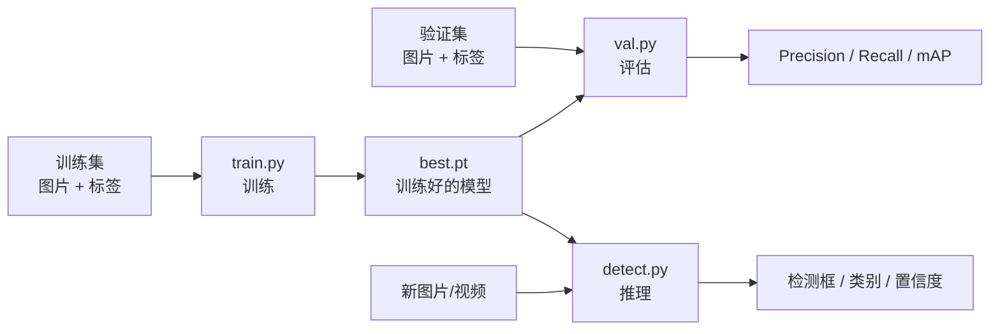

## 0.2 本项目使用的几个基础概念

### Python 文件、YAML 文件和 PT 文件的区别

- `.py`：程序代码，告诉电脑“怎么做”。例如 `train.py` 告诉电脑怎么训练。
- `.yaml`：配置文件，告诉程序“用什么数据、多少类别、网络怎么连接”。它通常不是独立运行的。
- `.pt`：PyTorch 模型权重或检查点，保存训练得到的参数。
- `.txt`：标签、依赖说明、脚本辅助配置等文本文件。
- `.csv`：表格数据，训练时通常每一行代表一个 epoch 的结果。
- `.jpg`、`.png`、`.mp4`：图片、曲线图或视频，通常是输入或输出。
- `.ipynb`：Jupyter Notebook，代码、文字和运行结果混合在一个文件里。

### 什么是类别

类别就是模型需要识别的目标类型。例如 `data/dfire.yaml` 中有两个类别：

```yaml
names:
  0: smoke
  1: fire
```

这里的数字必须和标签文件中的类别数字一致。标签中写 `0` 表示 `smoke`，写 `1` 表示 `fire`。

### 什么是 YOLO 标签

一个目标通常用一行文字描述：

```text
类别编号 x中心 y中心 宽度 高度
```

这些坐标通常已经归一化到 `0～1`。例如：

```text
1 0.52 0.46 0.20 0.30
```

表示这张图片里有一个编号为 `1` 的目标，中心位于图片宽度的 52%、高度的 46%，框宽占图片 20%，框高占图片 30%。

## 0.3 数据集的典型目录

检测任务一般使用下面的结构：

```text
dataset/
├─ images/
│  ├─ train/              训练图片
│  └─ val/                验证图片
└─ labels/
   ├─ train/              与 train 图片同名的标签
   └─ val/                与 val 图片同名的标签
```

例如：

```text
images/train/fire001.jpg
labels/train/fire001.txt
```

图片名和标签名必须对应。`fire001.jpg` 的标签应当是 `fire001.txt`。

分类任务不同，它通常不需要 `.txt` 标签，而是用文件夹名称表示类别：

```text
classification_dataset/
├─ train/
│  ├─ cat/
│  └─ dog/
└─ val/
   ├─ cat/
   └─ dog/
```

## 0.4 一个数据集 YAML 如何被使用

以 `data/dfire.yaml` 为例：

```yaml
path: ./datasets/dfire
train: train/images
val: val/images
names: ['smoke', 'fire']
```

含义是：

1. `path` 是数据集根目录。
2. `train` 是训练图片目录，相对于 `path`。
3. `val` 是验证图片目录，相对于 `path`。
4. `names` 定义类别名称和类别编号。
5. `utils/general.py` 中的 `check_dataset()` 会读取配置并拼接出实际路径。
6. `utils/dataloaders.py` 再把图片和标签做成 PyTorch DataLoader。

## 1. 一眼看懂项目

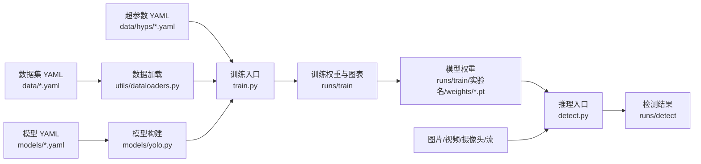

训练默认将权重保存在本次实验的输出目录；根目录下的 `weights/` 是本地另行整理的权重库，程序不会自动把每次训练结果搬到这里。

### 顶层目录树

```text
yolov5-master/
├─ assets/                   文档使用的图片
├─ classify/                 图像分类任务
├─ data/                     数据集、超参数和数据准备脚本
├─ models/                   网络模块和模型架构 YAML
├─ output/                   本地输出文件，具体用途以内容为准
├─ segment/                  实例分割任务
├─ tmp/                      本地临时工作目录，具体用途以内容为准
├─ utils/                    数据、损失、指标、日志、部署等公共能力
├─ weights/                  本地训练权重
├─ train.py                  检测训练入口
├─ val.py                    检测验证入口
├─ detect.py                 检测推理入口
└─ export.py                 模型导出入口
```

以上是当前主要目录与入口文件。运行后可能出现 `runs/train/`、`runs/val/`、`runs/detect/` 等输出目录；`--project` 可改变输出位置。使用 `testdata/` 作为输入前，需要自行建立目录并放入图片。

## 2. 根目录文件

| 文件 | 作用 | 何时使用 |
|---|---|---|
| `train.py` | 目标检测训练主程序。构建模型、读入数据、执行训练/验证、保存权重。 | 训练检测模型时。 |
| `val.py` | 检测模型验证程序。计算 Precision、Recall、mAP、混淆矩阵。 | 对权重做离线评估时。 |
| `detect.py` | 通用检测推理程序。支持图片、目录、视频、摄像头、屏幕和网络流。 | 部署前测试或批量推理时。 |
| `export.py` | 导出模型到 ONNX、TensorRT、OpenVINO、TFLite 等格式。 | 部署到不同推理框架时。 |
| `benchmarks.py` | 测量模型导出后各后端的速度和精度。 | 比较部署格式时。 |
| `hubconf.py` | PyTorch Hub 入口，供 `torch.hub.load()` 调用。 | 用 Python API 快速加载模型时。 |
| `convert_model.py` | 处理 Windows 与 Linux 间 `.pt` 文件中 `Path` 对象的兼容性。 | Linux 训练的权重无法在 Windows 加载时。 |
| `lookmodel.py` | 输出模型结构、参数量、模型大小、MACs/FLOPs。 | 分析某个 `.pt` 模型时。 |
| `visdrone2yolo.py` | 将 VisDrone 原始标注转换为 YOLO 标签。 | 首次准备 VisDrone 数据集时。 |
| `README.md` / `README.zh-CN.md` | 上游 YOLOv5 文档。 | 查询基础命令与功能时。 |
| `tutorial.ipynb` | 检测任务教程 Notebook。 | 交互式学习或试验时。 |
| `requirements.txt` | Python 运行依赖。 | 创建环境时。 |
| `pyproject.toml` | 项目元数据、可选依赖、格式化/测试工具配置。 | 打包或开发环境配置时。 |
| `extensions.txt` | 推荐 VS Code 扩展列表。 | 配置开发编辑器时。 |
| `CITATION.cff` | 学术引用信息。 | 论文或报告引用时。 |
| `CONTRIBUTING.md` | 上游贡献说明。 | 参与上游贡献时。 |
| `LICENSE` | AGPL-3.0 许可证。 | 分发或商用评估时。 |
| `.gitignore` / `.dockerignore` | Git、Docker 构建排除规则。 | 版本管理或构建镜像时。 |
| `.gitattributes` | Git 属性配置。 | Git 管理时。 |
| `Drone.pt` | 根目录的无人机检测权重副本。 | 旧脚本直接引用根目录权重时。 |
| `yolov5-master.zip` | 项目压缩备份。 | 归档或迁移时。 |

## 3. `models/`：模型定义

`models/` 回答的是“网络由什么层组成、模型 YAML 如何变成 PyTorch 网络”。

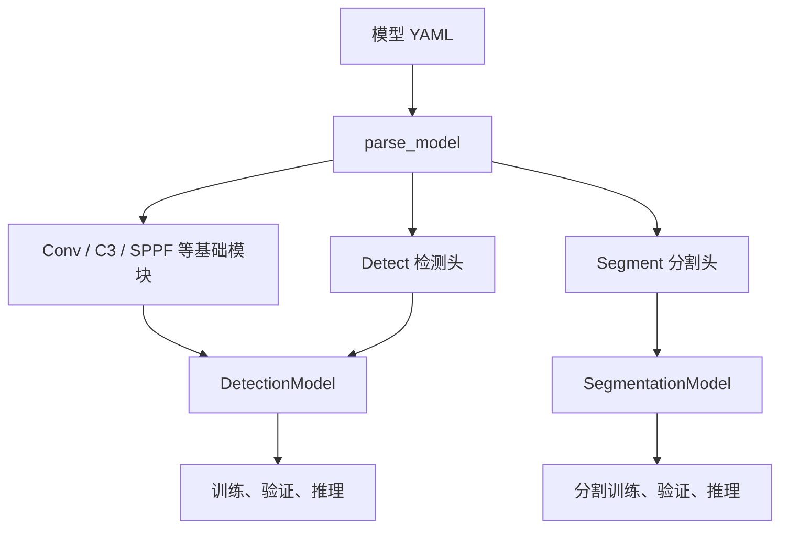

### 3.1 `models/` 中的 Python 文件

| 文件 | 内容 |
|---|---|
| `common.py` | 常用网络层：`Conv`、`DWConv`、`Bottleneck`、`C3`、`C3TR`、`C3Ghost`、`SPP`、`SPPF`、`Concat`；还包含 `DetectMultiBackend` 多后端模型加载器、`AutoShape` 输入适配器、`Detections` 结果包装器、`Proto` 分割原型层和 `Classify` 分类头。 |
| `yolo.py` | 模型组装核心。定义 `Detect`、`Segment`、`BaseModel`、`DetectionModel`、`SegmentationModel`、`ClassificationModel`；`parse_model()` 将 YAML 的层描述解析成 PyTorch 模块。 |
| `experimental.py` | 实验性组件：`MixConv2d`、`Ensemble`，以及加载单权重/多权重的 `attempt_load()`。 |
| `tf.py` | YOLOv5 的 TensorFlow/Keras 对应实现，主要供 SavedModel、TFLite、TF.js 导出链路使用。 |
| `__init__.py` | Python 包标记文件。 |

### 3.2 标准检测模型 YAML

| 文件 | 模型规模或用途 |
|---|---|
| `yolov5n.yaml` | Nano，最小、最快。 |
| `yolov5s.yaml` | Small，常用默认基线。 |
| `yolov5m.yaml` | Medium。 |
| `yolov5l.yaml` | Large。 |
| `yolov5x.yaml` | Extra Large，参数最多。 |
| `yolov5n-vec.yaml` | 本地 6 类轻量配置。 |
| `yolov5s-fire.yaml` | 本地火焰/烟雾两类检测配置。 |
| `yolov5s-Vis.yaml` | 本地 VisDrone 十类检测配置。 |

### 3.2.1 先回答一个最重要的问题：YOLOv5n/s/m/l/x 结构相同吗？

基本相同，但要把“结构相同”理解得准确一些：

> **标准 YOLOv5n、YOLOv5s、YOLOv5m、YOLOv5l、YOLOv5x 使用同一套总体拓扑，主要通过“深度缩放”和“宽度缩放”变成不同大小的模型。**

它们不是五种完全不同的算法，也不是把 Backbone、Neck、Head 全部重新设计了五遍。它们共享下面这条主线：

```text
输入图像
  ↓
Backbone：逐步下采样，提取从细节到语义的特征
  ↓
SPPF：扩大感受野，汇总不同尺度的上下文
  ↓
Neck：FPN 自顶向下 + PAN 自底向上，融合不同分辨率特征
  ↓
Head：在 P3/P4/P5 三个尺度上预测边界框、置信度和类别
```

五个标准规模的主要差异是：

| 规模 | 直观理解 | 深度系数 `depth_multiple` | 宽度系数 `width_multiple` | 典型取舍 |
|---|---|---:|---:|---|
| `n` | Nano，最小 | 0.33 | 0.25 | 参数量和计算量最小，适合边缘设备和实时场景 |
| `s` | Small，小型基线 | 0.33 | 0.50 | 速度与精度较均衡，常用于学习、实验和部署 |
| `m` | Medium，中型 | 0.67 | 0.75 | 精度、速度、显存之间进一步平衡 |
| `l` | Large，大型 | 1.00 | 1.00 | 特征表达能力更强，但更慢、更占显存 |
| `x` | Extra Large，超大 | 1.33 | 1.25 | 计算量最大，通常追求更高精度 |

因此可以记成一句话：

> `n/s/m/l/x` 是同一张“建筑图纸”的不同施工规模；`n` 更像小房子，`x` 更像大房子，但房间之间的连接关系基本一致。

这里说的是**标准检测模型**。带有 `P2`、`P6`、`seg`、`ghost`、`transformer`、`C3GC` 等后缀或模块名称的配置，可能真的改变了输出尺度、任务头或内部模块，不能简单地归入 n/s/m/l/x 的“纯缩放”范围。

官方架构说明把 YOLOv5 概括为 CSPDarknet53 Backbone、包含 SPPF 和 PANet 的 Neck，以及 YOLOv3 风格的 Head；官方说明还指出 v6.0 用一个 6×6 卷积替代了早期的 Focus，并用更快的 SPPF 替代 SPP。[官方 YOLOv5 架构说明](https://docs.ultralytics.com/yolov5/tutorials/architecture-description)

### 3.2.2 一张图看懂整个模型

下图先不纠结每一层的代码，重点观察信息是怎样流动的：

```mermaid
flowchart LR
    I[输入 640×640×3] --> B0[Conv 6×6 / stride 2<br/>P1/2：320×320]
    B0 --> B1[Conv 3×3 / stride 2<br/>P2/4：160×160]
    B1 --> B2[C3<br/>提取特征]
    B2 --> B3[Conv / stride 2<br/>P3/8：80×80]
    B3 --> F3[C3<br/>较细节的特征]
    F3 --> B5[Conv / stride 2<br/>P4/16：40×40]
    B5 --> F4[C3<br/>中等分辨率特征]
    F4 --> B7[Conv / stride 2<br/>P5/32：20×20]
    B7 --> F5[C3 + SPPF<br/>高语义特征]

    F5 --> R5[第10层 1×1 Conv<br/>20×20，保留此分支供 PAN 拼接]
    R5 --> U4[第11层 上采样<br/>40×40]
    U4 --> C4[第12层 Concat]
    F4 --> C4
    C4 --> N4[第13层 C3]
    N4 --> R4[第14层 1×1 Conv<br/>40×40，保留此分支供 PAN 拼接]
    R4 --> U3[第15层 上采样<br/>80×80]
    U3 --> C3[第16层 Concat]
    F3 --> C3
    C3 --> O3[第17层 C3<br/>P3/8 检测输入：80×80]

    O3 --> D4[第18层 下采样 Conv<br/>40×40]
    D4 --> P4C[第19层 Concat]
    R4 --> P4C
    P4C --> O4[第20层 C3<br/>P4/16 检测输入：40×40]
    O4 --> D5[第21层 下采样 Conv<br/>20×20]
    D5 --> P5C[第22层 Concat]
    R5 --> P5C
    P5C --> O5[第23层 C3<br/>P5/32 检测输入：20×20]

    O3 --> H[Detect 检测头]
    O4 --> H
    O5 --> H
    H --> R[推理时在 Detect 内解码<br/>随后置信度筛选 + NMS]
```

图中层号对应本地标准 `models/yolov5s.yaml`。FPN 路径在第 12、16 层与 Backbone 特征拼接；PAN 路径先下采样，再在第 19、22 层分别与第 14、10 层输出拼接。每个 Concat 的输入空间尺寸一致，拼接后再进入 C3。

从图中可以看到三个关键事实：

1. Backbone 越往后，特征图越小，但每个位置“看到”的原图范围越大，语义信息越强。
2. Neck 把深层语义信息传回高分辨率特征图，同时又把浅层的定位细节向后传递。
3. Head 不只在最后一张 20×20 特征图上检测，而是在 80×80、40×40、20×20 三张特征图上共同检测。

### 3.2.3 Backbone、Neck、Head 分别是什么

可以把目标检测模型想象成一条“看图—整理—作答”的流水线：

| 部分 | 像什么 | 它主要解决什么问题 | YOLOv5 中的代表模块 |
|---|---|---|---|
| Backbone | 眼睛和视觉皮层 | 从像素中提取边缘、纹理、形状和语义 | `Conv`、`C3`、`SPPF` |
| Neck | 信息整理员 | 将不同层级、不同分辨率的特征融合起来 | `Upsample`、`Concat`、`C3`，组成 FPN/PAN 结构 |
| Head | 答题器 | 根据融合后的特征输出框的位置、目标置信度和类别 | `Detect` |

#### Backbone：从大图逐步变成小图

Backbone 的每次 stride=2 下采样都会让宽和高大致减半：

```text
640×640  →  320×320  →  160×160  →  80×80  →  40×40  →  20×20
              /2          /4          /8        /16        /32
```

分辨率越高，通常越适合保留小目标的细节；分辨率越低，单个特征点对应的原图区域越大，通常越适合识别大目标和整体语义。

#### Neck：FPN + PAN 的双向融合

YOLOv5 的 Neck 可以理解为两条方向相反的信息通道：

- FPN 的自顶向下路径：从深层高语义特征开始，上采样后与浅层特征拼接，把“这是什么”传回高分辨率层。
- PAN 的自底向上路径：再通过 stride=2 的卷积向下传递，把浅层的边缘、位置等定位信息重新送回深层。

这就是为什么 YOLOv5 能同时照顾小目标和大目标：它不是只依赖某一层，而是让多个尺度的特征互相补充。

#### Head：三个尺度同时作答

标准 YOLOv5 检测头使用三张特征图：

| 输出层 | 相对输入的步长 | 输入为 640 时特征图大小 | 更擅长的目标 |
|---|---:|---:|---|
| P3 | 8 | 80×80 | 小目标 |
| P4 | 16 | 40×40 | 中等目标 |
| P5 | 32 | 20×20 | 大目标 |

这里的 P3/P4/P5 是尺度名称，不是类别名称。P3/8 的意思是：该特征图的步长为 8，输入图像中相邻两个特征点大致相隔 8 个像素。

### 3.2.4 以 640×640 输入追踪特征图尺寸

假设输入图片经过 letterbox 等预处理后是 `640×640`，标准 YOLOv5 的主要尺寸变化如下。表中的通道数先按 `yolov5s.yaml` 的基础配置书写；实际运行时还会受到 `width_multiple` 的影响，后面会专门解释。

| 层级/名称 | 典型操作 | 空间尺寸 | `yolov5s.yaml` 基础通道数 | 你可以怎样理解 |
|---|---|---:|---:|---|
| 输入 | RGB 图像 | 640×640 | 3 | 三个颜色通道 |
| P1/2 | 第一个 6×6 Conv，stride=2 | 320×320 | 64 | 初步提取边缘和纹理 |
| P2/4 | Conv，stride=2 | 160×160 | 128 | 开始形成更稳定的局部特征 |
| P3/8 | Conv，stride=2 后的 C3 | 80×80 | 256 | 保留较多细节，供小目标检测使用 |
| P4/16 | Conv，stride=2 后的 C3 | 40×40 | 512 | 细节与语义的中间层 |
| P5/32 | Conv，stride=2 后的 C3 | 20×20 | 1024 | 深层语义信息，供大目标检测使用 |

标准 Detect 最终产生的候选框数量可以这样算：

```text
P3：80 × 80 × 3 = 19,200
P4：40 × 40 × 3 =  4,800
P5：20 × 20 × 3 =  1,200
总计：              25,200 个候选框
```

这里的 `3` 是每个网格位置使用的 anchor 数量。25,200 不是最终检测框数量，而是模型在 NMS 之前生成的候选框数量；后面还会经过置信度筛选和 NMS。

### 3.2.5 逐层阅读 `models/yolov5s.yaml`

这是学习本仓库模型结构最重要的一张表。YAML 中每一层都用四个字段描述：

```yaml
[-1, 3, C3, [256]]
```

它们依次表示：

1. `-1`：输入来自上一层。
2. `3`：基础重复参数，先按深度系数缩放。对于 C3，缩放后的值传入一个 C3 内部，决定 Bottleneck 的串联数量；外部仍是一个 C3。
3. `C3`：使用哪个模块类。
4. `[256]`：传给该模块的参数，常见含义是输出通道数为 256。

标准 YAML 的完整数据流如下。`s` 配置中的通道数是“基础值”，真正构建时会乘以宽度系数并对齐到 8 的倍数。

| 层号 | 所在部分 | `from` | 实际模块与内部重复（s 模型） | 关键参数（通道为 YAML 基础值） | 640 输入时尺寸 | 作用 |
|---:|---|---|---|---|---:|---|
| 0 | Backbone | -1 | 1×`Conv` | 64，6×6，s=2 | 320×320 | 用大卷积核做输入 stem |
| 1 | Backbone | -1 | 1×`Conv` | 128，3×3，s=2 | 160×160 | 再次下采样 |
| 2 | Backbone | -1 | 1×`C3`，内部 1 个 Bottleneck | 128 | 160×160 | 在较高分辨率上提取特征 |
| 3 | Backbone | -1 | 1×`Conv` | 256，3×3，s=2 | 80×80 | 生成 P3 尺度 |
| 4 | Backbone | -1 | 1×`C3`，内部 2 个 Bottleneck | 256 | 80×80 | 细节特征主干，连接到 Neck |
| 5 | Backbone | -1 | 1×`Conv` | 512，3×3，s=2 | 40×40 | 生成 P4 尺度 |
| 6 | Backbone | -1 | 1×`C3`，内部 3 个 Bottleneck | 512 | 40×40 | 中等分辨率特征，连接到 Neck |
| 7 | Backbone | -1 | 1×`Conv` | 1024，3×3，s=2 | 20×20 | 生成 P5 尺度 |
| 8 | Backbone | -1 | 1×`C3`，内部 1 个 Bottleneck | 1024 | 20×20 | 深层语义特征 |
| 9 | Backbone | -1 | 1×`SPPF` | 1024，pool=5 | 20×20 | 扩大感受野，汇总上下文 |
| 10 | Neck | -1 | 1×`Conv` | 512，1×1 | 20×20 | 压缩通道，准备向上融合 |
| 11 | Neck | -1 | 1×`Upsample` | scale=2 | 40×40 | 放大到 P4 尺度 |
| 12 | Neck | `[-1, 6]` | 1×`Concat` | dim=1 | 40×40 | 与 Backbone 的 P4 特征拼接 |
| 13 | Neck | -1 | 1×`C3`，内部 1 个 Bottleneck | 512，shortcut=False | 40×40 | 融合并精炼 P4 特征 |
| 14 | Neck | -1 | 1×`Conv` | 256，1×1 | 40×40 | 压缩通道，准备继续向上 |
| 15 | Neck | -1 | 1×`Upsample` | scale=2 | 80×80 | 放大到 P3 尺度 |
| 16 | Neck | `[-1, 4]` | 1×`Concat` | dim=1 | 80×80 | 与 Backbone 的 P3 特征拼接 |
| 17 | Neck | -1 | 1×`C3`，内部 1 个 Bottleneck | 256，shortcut=False | 80×80 | 形成 P3/8 检测输入，小目标尺度 |
| 18 | Neck | -1 | 1×`Conv` | 256，3×3，s=2 | 40×40 | 从 P3 向下采样 |
| 19 | Neck | `[-1, 14]` | 1×`Concat` | dim=1 | 40×40 | 与 Neck 的中间特征拼接 |
| 20 | Neck | -1 | 1×`C3`，内部 1 个 Bottleneck | 512，shortcut=False | 40×40 | 形成 P4/16 检测输入，中目标尺度 |
| 21 | Neck | -1 | 1×`Conv` | 512，3×3，s=2 | 20×20 | 从 P4 向下采样 |
| 22 | Neck | `[-1, 10]` | 1×`Concat` | dim=1 | 20×20 | 与深层 Neck 特征拼接 |
| 23 | Neck | -1 | 1×`C3`，内部 1 个 Bottleneck | 1024，shortcut=False | 20×20 | 形成 P5/32 检测输入，大目标尺度 |
| 24 | Head | `[17, 20, 23]` | 1×`Detect` | `nc`、`anchors` | 三个尺度 | 同时输出 P3/P4/P5 的预测 |

官方的 `yolov5s.yaml` 也明确展示了这套从 Backbone 到三尺度 Detect 的层连接关系，可与本仓库的 `models/yolov5s.yaml` 逐行对照。[官方 yolov5s.yaml](https://github.com/ultralytics/yolov5/blob/master/models/yolov5s.yaml)

### 3.2.6 `n/s/m/l/x` 到底怎样改变层数和通道数

#### 深度缩放：改变重复次数

YAML 的 C3 行中，`number=3/6/9` 是基础重复参数。对于这些基础值，模型解析器先计算：

```text
C3 内部 Bottleneck 数 = max(round(number × depth_multiple), 1)
```

以 Backbone 中的四组 C3 为例：

| 模型 | `depth_multiple` | 四个 C3 内部的 Bottleneck 数（基础参数 `[3, 6, 9, 3]`） |
|---|---:|---|
| `n` | 0.33 | `[1, 2, 3, 1]` |
| `s` | 0.33 | `[1, 2, 3, 1]` |
| `m` | 0.67 | `[2, 4, 6, 2]` |
| `l` | 1.00 | `[3, 6, 9, 3]` |
| `x` | 1.33 | `[4, 8, 12, 4]` |

YAML 的 `head` 区段也包含 Neck 的特征融合层，其中 C3 的基础重复参数为 3，内部 Bottleneck 数在 `n/s` 中为 1、`m` 中为 2、`l` 中为 3、`x` 中为 4。`parse_model()` 将这个数量插入 C3 的构造参数，再把外部重复数设为 1。因此每行仍构建一个 C3；其他模块是否在外部重复，应按解析器的对应分支判断，不能一律套用 C3 的规则。上表“所在部分”按功能划分，YAML 的 `head` 键则同时容纳 Neck 与 Detect。

#### 宽度缩放：改变每层通道数

通道数可以粗略理解为“这一层同时学习多少组不同的特征”。宽度越大，表达能力通常越强，但参数量、计算量和显存占用也会增加。

```text
实际通道数 ≈ make_divisible(基础通道数 × width_multiple, 8)
```

以 Backbone 的主要基础通道 `[64, 128, 256, 512, 1024]` 为例：

| 模型 | `width_multiple` | 64 | 128 | 256 | 512 | 1024 |
|---|---:|---:|---:|---:|---:|---:|
| `n` | 0.25 | 16 | 32 | 64 | 128 | 256 |
| `s` | 0.50 | 32 | 64 | 128 | 256 | 512 |
| `m` | 0.75 | 48 | 96 | 192 | 384 | 768 |
| `l` | 1.00 | 64 | 128 | 256 | 512 | 1024 |
| `x` | 1.25 | 80 | 160 | 320 | 640 | 1280 |

这张表解释了为什么 `yolov5x` 不仅“层数更多”，而且每一层通常也“更宽”。于是它的参数量和 FLOPs 会明显增加。

> 小心一个常见误区：YAML 里看到的 64、128、256 等是基础通道，并不一定等于最终运行时通道。要判断真实结构，应同时查看 YAML 中的 `width_multiple` 和 `models/yolo.py` 里的 `parse_model()`。

### 3.2.7 `Conv`：YOLOv5 最常见的积木

在本项目的 `models/common.py` 中，YOLOv5 常用的 `Conv` 通常由三部分组成：

```text
Conv2d → BatchNorm2d → SiLU 激活
```

它们各自做的事情：

| 部件 | 小白版理解 |
|---|---|
| `Conv2d` | 用可学习的卷积核观察局部区域，提取边缘、纹理、形状等模式 |
| `BatchNorm2d` | 调整中间特征的分布，让训练过程更稳定 |
| `SiLU` | 非线性激活，让网络不只是简单地叠加线性变换 |

当 `stride=2` 时，这个 Conv 还承担下采样任务；当 `stride=1` 时，主要用于在同一空间分辨率上继续变换特征。

### 3.2.8 `C3`：为什么 YOLOv5 大量使用它

`C3` 是 YOLOv5 的核心模块之一。可以把它想成“一部分特征走深加工路线，另一部分特征走较短路线，最后再合并”：

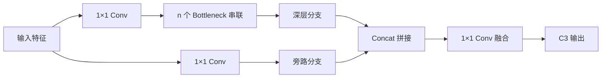

在本项目源码中，`C3` 的核心逻辑可以按以下顺序理解：

1. 输入先分成两个分支。
2. 一个分支进入若干个 `Bottleneck`，继续提取更复杂的特征。
3. 另一个分支相对直接地保留输入信息。
4. 两个分支沿通道维拼接。
5. 最后用卷积融合成新的输出。

这样做的学习意义是：深层分支负责丰富表达，旁路分支帮助保留信息并改善梯度传递；同时不让所有通道都必须经过同样深的计算。`C3` 内部的 Bottleneck 数量，就是前面 `depth_multiple` 影响模型大小的重要位置。

### 3.2.9 `SPP` 与 `SPPF`：扩大“看得到的范围”

#### 什么是感受野

如果一个特征点只依赖输入图像中很小的区域，它看到的可能只是局部纹理；如果它能综合更大范围的信息，就更容易判断一个物体的整体形状和上下文。这个“一个特征点能影响或看到的原图范围”可以先粗略理解成感受野。

#### `SPPF` 在做什么

本仓库 `models/common.py` 中的 `SPPF` 大致执行：

```text
输入
  ↓ 1×1 Conv，先压缩/调整通道
第一次 5×5 MaxPool
第二次 5×5 MaxPool
第三次 5×5 MaxPool
  ↓
把原始特征和三次池化结果 Concat
  ↓ 1×1 Conv 融合
输出
```

三次连续的 5×5、stride=1、适当 padding 的池化，得到的有效感受野可以对应到 5×5、9×9、13×13 三种范围，因此实现意图与 SPP 的多尺度池化相近，但串行池化通常更高效。官方文档也专门比较了 SPPF 与 SPP 的速度。[官方 SPP/SPPF 说明](https://docs.ultralytics.com/yolov5/tutorials/architecture-description)

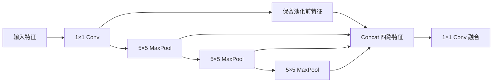

### 3.2.10 `Concat`：为什么要把不同层的特征拼起来

`Concat` 不是把两张图相加，而是通常沿通道维拼接：

```text
[batch, C1, H, W] + [batch, C2, H, W]
                 ↓ dim=1
        [batch, C1+C2, H, W]
```

因此参与拼接的两个特征图必须拥有相同的 `H`、`W`。YOLOv5 先用 `Upsample` 或 stride=2 Conv 把空间尺寸对齐，再使用 `Concat`。这种连接就是常说的 skip connection / shortcut path 的一种工程实现：浅层和深层信息能够直接汇合。

### 3.2.11 `Detect` 输出的每个数字是什么

标准检测头每个尺度使用 3 个 anchors。对于一个网格位置、一个 anchor，模型预测：

```text
5 + nc 个数字
```

其中：

| 数字 | 含义 |
|---|---|
| 4 个 | 边界框位置和大小：`x`、`y`、`w`、`h` |
| 1 个 | objectness，表示这个位置像不像有目标 |
| `nc` 个 | 每个类别的分类分数 |

所以：

- 如果本项目某个数据集有 `nc=2` 个类别，每个 anchor 输出 `5+2=7` 个数字，每个尺度的输出通道数为 `3×7=21`。
- 如果是 COCO 的 `nc=80`，每个 anchor 输出 `85` 个数字，每个尺度的输出通道数为 `3×85=255`。

在 `models/yolo.py` 的 `Detect` 中，可以把每个尺度的原始张量理解成：

```text
[batch, 3, 网格高, 网格宽, 5+nc]
```

以 `nc=2`、640 输入的 P3 为例：

```text
[batch, 3, 80, 80, 7]
```

训练模式返回的 `x/y/w/h` 是原始预测值，不能直接画框。推理时，Detect 结合网格位置和 stride（相邻特征点在输入图上间隔的像素数）解码出网络输入图上的中心坐标和宽高。objectness 与类别分数经 sigmoid 转成 0～1 的分数，后续再计算最终类别分数、筛选和 NMS。使用整数网格索引时，解码为：

```text
xy = (sigmoid(raw_xy) × 2 − 0.5 + 整数网格索引) × stride
wh = (sigmoid(raw_wh) × 2)² × 像素尺度的 anchor 宽高
objectness/class = sigmoid(raw_score)
```

例如 `raw_x=0`、整数网格列号为 10、`stride=8`，有 `sigmoid(0)=0.5`，中心横坐标为 `(2×0.5−0.5+10)×8=84` 像素。源码 `_make_grid()` 已把 `−0.5` 放进 `self.grid`，所以代码写成 `(xy×2+self.grid)×stride`；两种写法等价，不能再漏减或重复减去 0.5。

这里的像素属于**预处理后的网络输入图**。若原图经 Letterbox 等比例缩放并填充，Detect 解码后还需要转成角点坐标，再由 `detect.py` 的 `scale_boxes()` 去除填充、还原缩放并限制到原图边界，才能画回原图。

在当前 `non_max_suppression()` 中，每个类别的最终分数为 `objectness×该类别分数`，例如 `0.8×0.75=0.6`。图上显示的置信度通常来自这个乘积，不能直接当成单独的 objectness。

### 3.2.12 Anchor、网格与 NMS 的关系

#### Anchor 是什么

Anchor 可以理解为每个网格位置预先准备的几种“参考框形状”。标准配置中每个尺度有 3 个 anchor，每个 anchor 有宽和高，例如 `yolov5s.yaml` 里按 P3/P4/P5 分组保存了 3 组宽高。

模型并不是机械地照搬 anchor，而是在 anchor 基础上预测偏移和缩放。这样做能让模型更容易学习不同大小、长宽比的目标。

#### 网格是什么

P3 是 80×80 的网格，表示模型在这一尺度上有 6,400 个网格位置；每个位置再配 3 个 anchor，于是得到 19,200 个候选框。P4 和 P5 同理。

#### NMS 是什么

同一个目标往往会产生多个相互重叠的候选框。NMS（Non-Maximum Suppression，非极大值抑制）大致会：

1. 按置信度从高到低排序。
2. 保留分数最高的框。
3. 删除与它重叠程度过高的同类框。
4. 对剩余框重复处理。

所以“模型原始输出 25,200 个候选框”与“最终图片上显示几个框”是两个不同阶段。

### 3.2.13 AutoAnchor：让 Anchor 更贴合你的数据集

#### 它解决什么问题

前面提到，标准 YOLOv5 的 P3/P4/P5 三个检测尺度各有 3 个 Anchor，默认一共 9 个 Anchor。这些默认 Anchor 是为通用数据集准备的；如果你的数据集中的目标尺寸和长宽比与默认数据集差别很大，例如：

- 无人机俯视图里几乎全是很小的车辆或行人；
- 工业缺陷又细又长；
- 火焰、烟雾、零件等目标的长宽比非常特殊；
- 训练图片尺寸、裁剪方式与常见 COCO 图片差异很大；

那么默认 Anchor 可能不够贴合。AutoAnchor 的作用是：**先量化默认 Anchor 与训练集标注框大小是否匹配；只有匹配得不好时，才从训练集的真实标注框中重新寻找更合适的 Anchor。**

它不是重新训练整个模型，也不是修改标签；它只服务于 anchor-based 检测头的“参考框尺寸”。本仓库的实现位于 `utils/autoanchor.py`，训练入口在 `train.py` 调用 `check_anchors()`。官方对应实现也采用“检查 BPR → 必要时 K-means → 遗传算法微调”的流程。[官方 autoanchor.py](https://github.com/ultralytics/yolov5/blob/master/utils/autoanchor.py) · [官方 train.py 调用点](https://github.com/ultralytics/yolov5/blob/master/train.py)

#### 它在训练流程中的位置

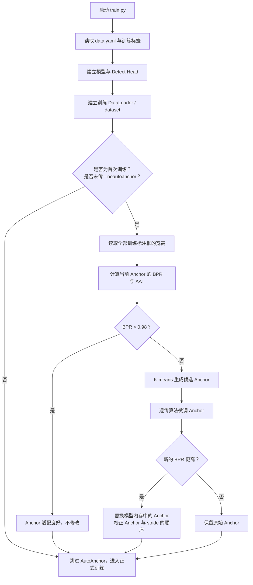

在这个仓库的 `train.py` 中，AutoAnchor 只在以下条件同时成立时运行：

1. 当前不是从中断训练继续的 `--resume`。
2. 没有传入 `--noautoanchor`。
3. 当前进程是单卡训练进程或 DDP 的 rank 0，避免多卡训练时每张卡重复做同一件事。

因此，正常从头训练会自动检查一次；断点续训默认不再重复检查。关闭方式是：

```powershell
python train.py --data data/xxx.yaml --weights yolov5s.pt --noautoanchor
```

一般新手不需要关闭它。只有你明确想固定 YAML 中的 Anchor、复现实验、或正在比较不同 Anchor 方案时，才建议加这个参数。

#### 第一步：把标签框转换成可比较的宽高

YOLO 标签中的宽高是相对比例，例如：

```text
class_id  x_center  y_center  width  height
0         0.50      0.50      0.10   0.20
```

其中 `0.10`、`0.20` 不是像素，而是相对于原图宽高的比例。AutoAnchor 会根据每张训练图片原始尺寸和本次训练的 `imgsz`，把所有标签的 `w/h` 换算到近似的训练像素尺度。它还会随机乘以 0.9 到 1.1 的轻微缩放系数，让评估不要只对应某一个固定缩放状态。

可以把它理解为把所有真实标注框整理成一张表：

| 目标编号 | 宽（训练尺度像素） | 高（训练尺度像素） |
|---:|---:|---:|
| 1 | 18 | 26 |
| 2 | 42 | 35 |
| 3 | 180 | 110 |
| … | … | … |

后续的判断和聚类只看框的宽、高，不看类别、不看框中心坐标，也不直接看图片内容。换句话说，AutoAnchor 解决的是“尺寸和长宽比匹配”问题，不会理解“这是火焰还是汽车”。

#### 第二步：怎样判断一个 Anchor 与一个真实框匹配

假设真实框宽高为 `wh=(w,h)`，某一个 Anchor 宽高为 `k=(aw,ah)`。代码会先算两个方向的比例：

```text
r = wh / k
```

再把“比 Anchor 大多少”和“比 Anchor 小多少”统一成不大于 1 的分数：

```text
x = min(r, 1/r) 的宽高两项中较小的那一个
```

这听起来抽象，可以看一个例子。设 `anchor=(40, 20)`：

| 真实框 | 宽度匹配程度 | 高度匹配程度 | `x` | 直觉 |
|---|---:|---:|---:|---|
| `(40, 20)` | 1.00 | 1.00 | 1.00 | 完全相同 |
| `(80, 40)` | 0.50 | 0.50 | 0.50 | 两边都大一倍，仍然较匹配 |
| `(20, 80)` | 0.50 | 0.25 | 0.25 | 高度比例差较大，处于阈值边缘 |
| `(8, 160)` | 0.20 | 0.125 | 0.125 | 长宽比差异太大，不匹配 |

本仓库默认超参数是 `anchor_t: 4.0`。因此通过阈值的条件为：

```text
x > 1 / anchor_t = 1 / 4 = 0.25
```

直观说，只要真实框和某个 Anchor 的宽、高都没有相差超过约 4 倍，就可把它视为一个“可用匹配”。这里使用的是宽高比例指标，不是 IoU；所以它评估的是 Anchor 形状与尺寸的先验适配度。

#### 两个核心指标：BPR 与 AAT

AutoAnchor 日志中最重要的两个量是：

| 指标 | 全称 | 代码中的含义 | 小白版理解 |
|---|---|---|---|
| BPR | Best Possible Recall | 每个真实框只要存在至少一个 Anchor 通过阈值，就记为可覆盖；BPR 是可覆盖真实框的比例 | “如果暂时不考虑模型能力，Anchor 的形状理论上最多能覆盖多少标注框” |
| AAT | Anchors Above Threshold | 每个真实框平均有多少个 Anchor 通过阈值 | “平均一个真实框有几个候选参考框可用” |

用公式写就是：

```text
best_i = 第 i 个真实框在所有 Anchor 中得到的最大 x
BPR    = mean(best_i > 1 / anchor_t)
AAT    = mean(第 i 个真实框中 x > 1 / anchor_t 的 Anchor 个数)
```

关键提醒：**BPR 不是验证集 Recall，也不是模型最终召回率。**它不使用模型预测结果，只判断“至少有一个 Anchor 的尺寸是否足够接近真实框”。所以 BPR 很低通常提示 Anchor 不合适；BPR 很高也不等于模型一定训练得好。

代码以 `BPR > 0.98` 作为“当前 Anchor 已经适配良好”的判断线：

```text
AutoAnchor: 3.20 anchors/target, 0.996 Best Possible Recall (BPR).
AutoAnchor: Current anchors are a good fit to dataset ✅
```

这段日志表示：平均每个真实框约有 3.20 个 Anchor 通过阈值，理论可覆盖率为 99.6%，因此程序不会继续优化。

#### 第三步：BPR 不够时，K-means 如何产生初始 Anchor

如果当前 BPR 不超过 0.98，AutoAnchor 会调用 `kmean_anchors()`。标准 YOLOv5 P3/P4/P5 有 3 个检测层、每层 3 个 Anchor，因此通常搜索 `n=9` 个 Anchor；如果你的 YAML 改成 4 个检测尺度且每层仍有 3 个 Anchor，例如某些 P2/P3/P4/P5 配置，搜索数量会随 Detect Head 中实际 Anchor 总数变为 12。

K-means 阶段的流程：

1. 收集训练集所有真实框的像素宽高。
2. 统计并警告极小框；代码会过滤掉宽和高都小于 2 像素的框，避免这些几乎不可学习的框主导聚类。
3. 先按宽、高各自的标准差进行白化（whitening），避免“宽度数值更大”单独主导距离计算。
4. 用 SciPy 的 `kmeans(..., iter=30)` 找到 `n` 个宽高中心，作为初始 Anchor。
5. 若 K-means 失败（例如有效标注框太少或分布过于重复），回退为随机初始化，再继续后面的优化。

K-means 的结果只是一个起点：它能从数据中找出常见尺寸簇，但未必直接使 BPR 最好，因此还有下一步的遗传算法。

#### 第四步：遗传算法如何继续改进

遗传算法不是“训练神经网络”，而是不断试探 Anchor 宽高的轻微变化：

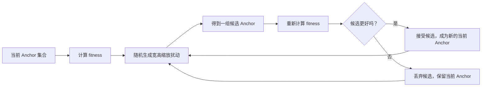

本仓库默认执行 1000 代。每一代会对 Anchor 宽高乘上一个随机扰动，再把比例裁剪在合理范围，并保证 Anchor 最小边不低于 2 像素。它的 fitness 是：

```text
fitness = mean(best × (best > 1 / anchor_t))
```

这意味着：既希望真实框能被某个 Anchor 覆盖，也希望覆盖时的匹配分数尽可能高。只有新候选的 fitness 优于当前 fitness 时，程序才接受它。

#### 第五步：什么时候真正替换模型 Anchor

K-means + 遗传算法完成后，程序会重新计算新 Anchor 的 BPR：

| 条件 | 程序行为 |
|---|---|
| 新 BPR 高于旧 BPR | 把新 Anchor 写入当前模型的 `Detect` 模块，随后继续训练 |
| 新 BPR 不高于旧 BPR | 保留 YAML/模型原本的 Anchor，仍然继续训练 |

当新 Anchor 被接受时，程序还会调用 `check_anchor_order()`：小 Anchor 应该对应较小 stride 的输出层（如 P3/8），大 Anchor 应该对应较大 stride 的输出层（如 P5/32）。如果 Anchor 面积的排列方向与 stride 方向相反，程序会翻转 Anchor 组的顺序。

还有一个非常容易混淆的实现细节：

```text
评估 / 重新生成时：Anchor 使用像素尺度
写进 Detect 后：Anchor 会除以对应 stride，存为网格尺度
推理解码时：再乘 stride，还原为像素尺度
```

所以你在 YAML、日志、`m.anchors` 张量中看到的数字不一定相同；它们可能只是处在不同坐标尺度。程序本身会完成转换。

#### AutoAnchor 会不会自动修改 YAML 文件？

不会。接受新 Anchor 后，AutoAnchor 修改的是**本次训练内存中的模型**，并输出提示：你可以选择日后把新的 Anchor 手动更新到模型 YAML。训练产生的 checkpoint 会保存当次模型状态，但原始 `models/yolov5*.yaml` 文件不会被 AutoAnchor 自动改写。

这点对实验很重要：如果你希望以后完全复现实验，建议记录训练日志中的最终 Anchor，或者手动保存一份带新 Anchor 的模型 YAML；不要只依赖“某次训练时 AutoAnchor 自动算过”。

#### 新手如何阅读 AutoAnchor 日志

| 日志现象 | 含义 | 建议 |
|---|---|---|
| `Current anchors are a good fit`，BPR 高于 0.98 | 当前 Anchor 已足够贴合标签框尺寸 | 正常训练即可 |
| `Anchors are a poor fit ... attempting to improve` | 默认 Anchor 与数据集尺寸分布差异较大 | 等待 K-means/遗传算法完成，不必立刻中断 |
| `Done ✅` | 新 Anchor 的 BPR 更高，已应用到本次模型 | 记录日志中的 Anchor；需要长期复现时可手动写入 YAML |
| `Done ⚠️ (original anchors better)` | 新搜索结果没有优于原 Anchor | 程序安全地保留原 Anchor，正常训练 |
| `Extremely small objects found` | 存在极小标注框 | 检查标注质量、提高 `imgsz`、考虑 P2 检测层；只改 Anchor 往往不够 |
| 传入 `--noautoanchor` | 完全跳过检查和优化 | 仅在你有明确目的时使用 |

#### 与 n/s/m/l/x、P2 结构的关系

标准 `yolov5n/s/m/l/x` 的主要区别是深度和宽度缩放，标准 Detect Head 都是 P3/P4/P5 三尺度、通常共 9 个 Anchor。因此换 `s`、`m`、`l` 并不天然意味着必须重新做 AutoAnchor；是否需要优化取决于**数据集标注框的尺寸分布**。

而 P2 小目标改进模型会增加更高分辨率的检测尺度。它能让网络在更细的网格上预测小目标，但并不能自动保证 Anchor 合适。对于本仓库中使用 P2 输出的自定义 YAML，AutoAnchor 会按 Detect Head 中实际 Anchor 总数进行检查与搜索；如果目标极小，仍应同时检查输入分辨率、标签质量、检测尺度设计和数据增强策略。

#### 你可以怎样把它与本仓库源码对应起来

| 想确认的问题 | 文件 | 对应函数/位置 |
|---|---|---|
| 训练何时触发 AutoAnchor | `train.py` | `check_anchors(dataset, model=model, thr=hyp["anchor_t"], imgsz=imgsz)` |
| 如何检查 Anchor 顺序 | `utils/autoanchor.py` | `check_anchor_order()` |
| 如何计算 BPR、AAT | `utils/autoanchor.py` | `check_anchors()` 内部 `metric()` |
| 如何做 K-means 与遗传算法 | `utils/autoanchor.py` | `kmean_anchors()` |
| 默认阈值是多少 | `data/hyps/hyp.scratch-low.yaml` 等超参数文件 | `anchor_t: 4.0` |
| Anchor 最终如何参与预测解码 | `models/yolo.py` | `Detect._make_grid()` 与 `Detect.forward()` |

学习时建议按这个顺序打开源码：先看 `train.py` 的调用条件，再看 `check_anchors()` 的 BPR/AAT 指标，最后看 `kmean_anchors()` 的 K-means 和遗传算法。这样能把“训练日志里的一行 AutoAnchor”准确对应到代码行为。

### 3.2.14 标准 n/s/m/l/x 的差别总结

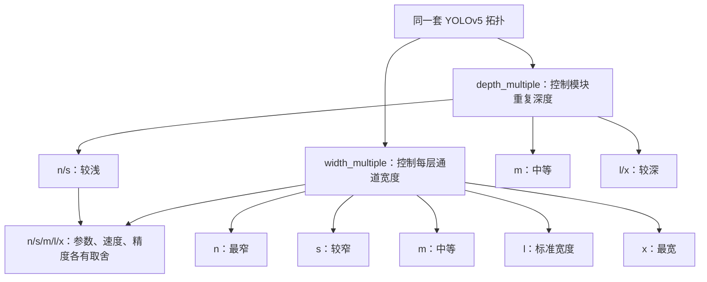

| 关注点 | `n/s` | `m` | `l/x` |
|---|---|---|---|
| 结构连接关系 | 基本相同 | 基本相同 | 基本相同 |
| Backbone/Head 深度 | 较浅 | 中等 | 较深 |
| 每层通道数 | 较少 | 中等 | 较多 |
| 参数量/FLOPs | 较小 | 中等 | 较大 |
| 推理速度 | 通常更快 | 中等 | 通常更慢 |
| 显存需求 | 较低 | 中等 | 较高 |
| 适合场景 | 实时、边缘设备、快速迭代 | 资源允许时的综合平衡 | 更重视精度、设备资源充足 |

没有脱离数据集和硬件的“永远最好模型”。例如一个小目标很多的数据集，换更大的模型不一定比改善输入分辨率、标注质量和数据增强更有效；在边缘设备上，`n/s` 可能比 `l/x` 更有实际价值。

### 3.2.15 不要把“模型规模”和“结构变体”混淆

| 名称形式 | 它通常表示什么 | 是否只是 n/s/m/l/x 缩放 |
|---|---|---|
| `yolov5s.yaml` | Small 标准检测模型 | 是，标准基线 |
| `yolov5m.yaml` | Medium 标准检测模型 | 是，主要变深、变宽 |
| `yolov5s-seg.yaml` | Small + 分割任务头 | 否，Head 和输出任务改变 |
| `yolov5s6.yaml` | P6 相关结构，增加更深尺度 | 否，检测尺度/拓扑改变 |
| `yolov5s-C3GC-*.yaml` | 使用本地 C3GC 模块 | 否，内部模块改变 |
| `yolov5P2-*.yaml` | 增加 P2 小目标检测尺度 | 否，输出分支改变 |
| `ghost`、`transformer`、`CBAM` | 用轻量、注意力或 Transformer 类模块替换/增强部分积木 | 否 |

对于本仓库尤其要注意：`models/yolov5s-C3GC-E.yaml` 和 `models/yolov5s-C3GC-P.yaml` 使用了 P2/P3/P4 输出思路，已经不是标准 P3/P4/P5 三尺度拓扑；`data/tricks/C3GC.py` 则提供了本地 `C3GC` 模块实现。它们可以作为“如何改 YOLOv5 结构”的学习案例。

### 3.2.16 模型结构与本仓库源码的对应关系

| 学习问题 | 建议先看哪个文件 | 重点看什么 |
|---|---|---|
| YAML 如何变成 PyTorch 网络 | `models/yolo.py` | `parse_model()`、`DetectionModel`、`Detect` |
| `Conv`、`C3`、`SPP`、`SPPF` 怎么实现 | `models/common.py` | 各模块的 `__init__()` 和 `forward()` |
| 自定义 C3GC 怎么接入 | `data/tricks/C3GC.py`、`models/yolo.py` | 模块定义、导入、`eval(m)` 找类的过程 |
| 标签如何参与训练 | `utils/loss.py` | box loss、objectness loss、classification loss |
| 预测框如何评估 | `utils/metrics.py` | IoU、Precision、Recall、mAP |
| 输入如何进入模型 | `detect.py`、`models/common.py` | 图片预处理、推理、结果绘制 |
| 训练如何调用模型 | `train.py` | 加载 YAML、数据集、优化器、保存权重 |

最推荐的阅读路线是：先读 `models/yolov5s.yaml` 的 0–24 层，再打开 `models/yolo.py` 看 `parse_model()` 如何解释每一行，最后回到 `models/common.py` 看 `Conv`、`C3`、`SPPF` 的内部。这样你会把“配置文件中的一行”与“真正执行的 Python 模块”对应起来。

### 3.2.17 用一句伪代码串起模型构建过程

```python
# 这不是可直接运行的完整代码，只用于理解
for layer_definition in yaml["backbone"] + yaml["head"]:
    from_index, repeat, module_name, args = layer_definition
    module_class = find_module(module_name)
    repeat = max(round(repeat * depth_multiple), 1) if repeat > 1 else repeat
    # 根据模块类型补充输入通道、缩放输出通道；Concat/Detect 等另行处理
    args = prepare_args(module_class, args, width_multiple, from_index)
    if module_class is C3:
        args.insert(2, repeat)  # C3 的输入/输出通道之后插入内部 Bottleneck 数
        repeat = 1            # 外部只构建一个 C3
    module = build(module_class, args, outer_repeat=repeat)
    layers.append(module)

# Head 将第 17、20、23 层的特征交给 Detect
prediction = Detect([feature_17, feature_20, feature_23])
```

真正的实现会处理更多模块类型、输入通道、Concat 后通道数、保存哪些中间层以及分割/分类任务，但主思路就是：**读取 YAML → 找到模块类 → 按深度和宽度缩放 → 连接各层 → 交给任务头输出结果**。

### 3.2.18 标签匹配与损失函数：模型到底怎样学会检测目标

前面的模型结构回答了“网络长什么样”，这一节回答更核心的问题：

> 图片和标签送进模型后，YOLOv5 怎样判断哪些预测是对的、哪些预测是错的，又怎样把这些错误变成可以更新网络权重的数字？

可以把一次训练理解成下面这件事：

```text
模型先猜 → 把真实标签分配给合适的网格/Anchor → 比较“猜”和“真实”
       → 计算 box/obj/cls 三类损失 → 反向传播 → 调整卷积权重
```

其中“标签匹配”决定了**谁负责学习这个真实目标**；“损失函数”决定了**这个负责的预测错了多少**。如果这两步没有理解，单看 loss 数值很容易只会“看曲线”，却不知道模型为什么会变好或变坏。

#### 一张图看完整训练目标生成过程

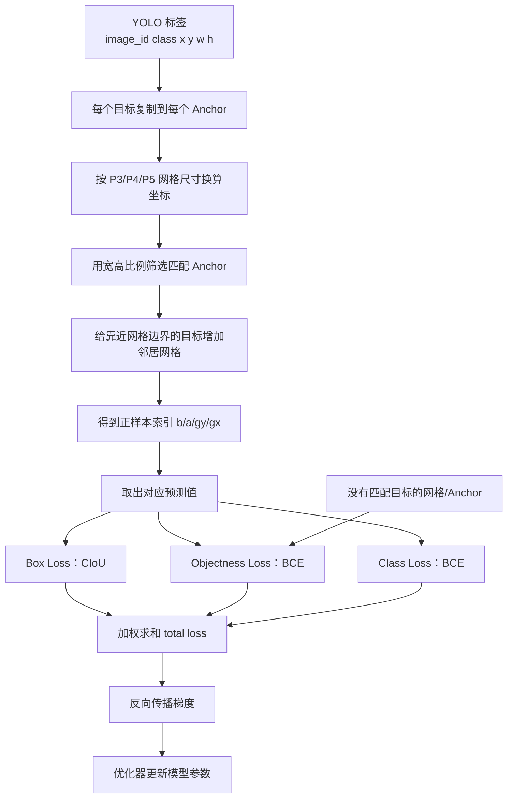

### 3.2.19 YOLO 标签在进入损失函数前是什么样

本项目检测标签每一行是：

```text
class_id  x_center  y_center  width  height
```

例如：

```text
1  0.53  0.47  0.10  0.20
```

它表示：第 `1` 类目标的中心在图片宽度的 `53%`、高度的 `47%`，目标宽度占图片宽度 `10%`，目标高度占图片高度 `20%`。

在 `utils/loss.py` 中，训练批次的 `targets` 还会多带一个图片编号，逻辑上变成：

```text
image_index  class_id  x_center  y_center  width  height
```

为什么需要 `image_index`？因为一个 batch 可能同时包含多张图片；模型需要知道每个真实框属于 batch 中的哪一张图片。类别编号、中心坐标和宽高仍然是标签本身的信息。

标签中的坐标和宽高一开始是相对比例，但检测头的每个尺度使用网格坐标。例如输入为 `640×640` 时：

| 检测尺度 | 网格尺寸 | 上例目标中心换算 | 目标宽高换算 |
|---|---:|---|---|
| P3/8 | 80×80 | `(0.53×80, 0.47×80) = (42.4, 37.6)` | `(0.10×80, 0.20×80) = (8, 16)` |
| P4/16 | 40×40 | `(21.2, 18.8)` | `(4, 8)` |
| P5/32 | 20×20 | `(10.6, 9.4)` | `(2, 4)` |

同一个真实目标会在不同检测尺度上得到不同的网格宽高。小目标在 P3 上通常拥有更多空间细节，大目标在 P5 上通常更容易表示。

### 3.2.20 `build_targets()`：真实目标怎样找到负责它的预测位置

本仓库的标签匹配主要位于 `utils/loss.py` 的 `ComputeLoss.build_targets()`。这个函数并不直接计算 loss，而是先返回后续计算 loss 所需的四类信息：

```text
tcls    每个正样本对应的类别
tbox    每个正样本对应的局部框目标
indices 每个正样本位于哪张图、哪个 Anchor、哪个网格行列
anch    每个正样本使用的 Anchor
```

可以把它看成“发任务单”：

```text
第 3 张图、第 2 个 Anchor、P3 网格第 37 行第 42 列：
你负责学习这个真实目标，类别是 1，框的局部目标是……
```

#### 第一步：每个真实框先尝试所有 Anchor

假设每个检测尺度有 3 个 Anchor。对一个真实框来说，代码会把它复制 3 份，分别标记为 Anchor 0、Anchor 1、Anchor 2，然后比较它的宽高和这 3 个 Anchor 是否匹配。

注意：这里的 Anchor 是在当前检测尺度的网格坐标中使用的。模型初始化时，`models/yolo.py` 会根据 stride 将 YAML 中的像素 Anchor 转成对应的网格尺度，因此 P3、P4、P5 的 Anchor 数值不同。

#### 第二步：用宽高比例筛选匹配 Anchor

代码核心判断可以简化成：

```python
r = target_wh / anchor_wh
match = max(r, 1 / r).max(width_height) < anchor_t
```

默认 `anchor_t=4.0` 时，含义是：真实框的宽、高相对于某个 Anchor 的比例，在两个方向上都不能超过约 4 倍差异。

这和前面 AutoAnchor 的 BPR 判断有关，但两者不是同一个过程：

| 对比项 | AutoAnchor | `build_targets()` |
|---|---|---|
| 目的 | 判断整个数据集是否适合当前 Anchor | 为当前 batch 的真实框寻找训练负责人 |
| 处理范围 | 通常查看整个训练集的框宽高 | 每个训练 batch 的标签 |
| 输出 | BPR/AAT，必要时生成新 Anchor | `indices/tbox/anch/tcls` 正样本目标 |
| 发生时间 | 正式训练前检查一次 | 每个 batch 计算 loss 时执行 |
| 主要尺度 | 像素尺度 Anchor | 转换到各检测层网格尺度 |

因此，AutoAnchor 不是 `build_targets()` 的替代品。即使 AutoAnchor 判断默认 Anchor 很合适，训练时仍然要对每个 batch 执行标签匹配。

#### 第三步：为什么一个真实框可能匹配多个 Anchor

YOLOv5 不是规定“一个真实框只能对应一个 Anchor”。只要多个 Anchor 都通过比例阈值，它们都可能成为正样本。这样做的好处是：目标不必被迫交给一个形状并不理想的参考框，多个合适预测位置可以共同学习。

举例来说，如果某个真实框与 P3 的 Anchor 0、Anchor 1 都匹配，那么 P3 这一层可能生成两个正样本；如果它还与 P4 的一个 Anchor 匹配，那么 P4 也会有一个正样本。最终哪个预测在推理时胜出，还要看模型训练出的置信度、框质量和 NMS。

#### 第四步：为什么还要给相邻网格增加正样本

目标中心可能刚好靠近网格边界。例如目标中心的网格坐标是 `(42.05, 37.90)`，它虽然属于第 42 列、第 37 行，但位置非常靠近相邻网格。若只让一个网格负责，微小的定位误差可能让训练变得不稳定。

本仓库使用中心网格加上最多四个相邻方向：

```text
中心：       ( 0,  0)
右侧邻居：   (+1,  0)
下侧邻居：   ( 0, +1)
左侧邻居：   (-1,  0)
上侧邻居：   ( 0, -1)
```

代码只会在目标中心靠近网格边界、且邻居仍然有效时加入这些偏移，因此不是每个真实框都会固定产生 5 份目标。这个机制可以理解为“给边界附近的目标多几个合理的候选负责人”，而不是把目标复制到整张网格。

#### 第五步：把连续坐标拆成网格索引和局部偏移

以 P3 上的网格坐标 `(42.4, 37.6)` 为例：

```text
网格索引：       gx=42, gy=37
网格内局部中心： tx=0.4, ty=0.6
```

上例只对应目标中心所在的网格。一般情况下，局部中心目标的定义是“目标连续网格坐标减去本次负责网格的整数索引”；加入邻居网格后，它不一定是小数部分：

| 同一个目标的连续网格坐标 | 负责网格的列、行索引 | 相对于负责网格的局部中心 |
|---|---|---|
| `(42.4, 37.6)` | `(42, 37)`，中心所在网格 | `(0.4, 0.6)` |
| `(42.4, 37.6)` | `(41, 37)`，左邻居 | `(1.4, 0.6)` |
| `(42.4, 37.6)` | `(42, 38)`，下邻居 | `(0.4, −0.4)` |

因此邻居网格的局部中心可以大于 1 或小于 0。这与预测端的 `2×sigmoid−0.5` 相配合：它把每个坐标分量的可表示范围扩展到 `−0.5～1.5` 之间，使相邻网格也能负责附近目标。`build_targets()` 使用半格偏移选择负责网格，再计算局部中心。

返回的框目标可写成：

```text
tbox = [局部中心x, 局部中心y, 目标宽度（网格单位）, 目标高度（网格单位）]
```

这里后两项是**目标框的宽高**，不是整张特征图的网格数量。后续正样本预测框也使用同一坐标体系，才能与目标框计算 CIoU。

最后，网格索引会被限制在合法范围内：

```text
gi ∈ [0, grid_width - 1]
gj ∈ [0, grid_height - 1]
```

这样可以避免边界偏移把索引带到特征图之外。

### 3.2.21 正样本、负样本和忽略项

#### 正样本是什么

经过 `build_targets()` 匹配后，被分配到某个真实目标的 `(图片、Anchor、网格行、网格列)` 位置，就是正样本。正样本要学习：

- 这个目标的框位置和大小；
- 这里确实存在目标；
- 目标属于哪个类别。

#### 负样本是什么

一个特征图上有大量网格和 Anchor 没有匹配任何真实框。这些位置通常是负样本，它们的 objectness 目标为 0，应该学会“这里没有目标”。

因此检测损失并不是只比较真实框那几个位置；objectness loss 会覆盖整张特征图的网格/Anchor。否则模型可能在背景位置随便输出高置信度而不受惩罚。

#### YOLOv5 这里没有把所有负样本都当作分类样本

在本项目的实现中，分类损失只对正样本计算，因为背景位置没有“属于哪一个目标类别”这个问题；背景主要通过 objectness loss 被压低。

可用下面这张表记忆：

| 样本类型 | Box Loss | Objectness Loss | Class Loss |
|---|---|---|---|
| 正样本 | 计算 | 计算 | 多类别时计算 |
| 未匹配的背景位置 | 不计算 | 目标为 0，计算 | 不计算 |

### 3.2.22 `ComputeLoss` 的三部分损失

`utils/loss.py` 中的 `ComputeLoss.__call__()` 对每个检测尺度依次处理，最后将三部分损失加权求和：

```text
total_loss = box_weight × Lbox
           + obj_weight × Lobj
           + cls_weight × Lcls
```

然后再乘以 batch size，作为训练循环中反向传播的总损失。日志里常见的 `box_loss`、`obj_loss`、`cls_loss`，就是这三类损失的记录。

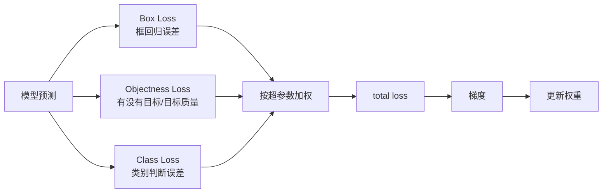

#### 1. Box Loss：框的位置和大小是否准确

对每一个正样本，代码先从预测张量中取出：

```text
pxy：用于生成局部中心的原始预测值
pwh：用于生成宽高的原始预测值
```

再按 YOLOv5 的解码方式得到网格单位的预测框，并与真实 `tbox` 计算 CIoU。以下为计算步骤示意，`anchor` 与 `tbox` 均指当前尺度已匹配的正样本：

```python
pxy = pxy.sigmoid() * 2 - 0.5
pwh = (pwh.sigmoid() * 2) ** 2 * anchor
pbox = torch.cat((pxy, pwh), dim=1)
ciou = bbox_iou(pbox, tbox, CIoU=True).squeeze()
lbox += (1 - ciou).mean()
```

先区分两个量：普通 IoU 是“交集面积÷并集面积”，范围为 0～1；CIoU 在普通 IoU 上减去中心距离与长宽比惩罚。因此本仓库的框损失是 `1−CIoU`，CIoU 可以为负数，框损失也可以大于 1。

| 两个框的示例（中心x、中心y、宽、高） | 普通 IoU | CIoU（约值） | 本仓库的框损失 `1−CIoU`（约值） |
|---|---:|---:|---|
| `(0,0,2,2)` 与自身完全重合 | 1 | 1 | 0 |
| `(0,0,2,2)` 与 `(1,0,2,2)` 部分重合 | 1/3 | 0.256 | 0.744 |
| `(0,0,2,2)` 与 `(4,0,2,2)` 不重合 | 0 | −0.4 | 1.4 |

表中两框宽高相同，长宽比惩罚为 0；最后一行的中心距离平方为 16，最小外接矩形的对角线平方为 40，所以 `CIoU=0−16/40=−0.4`。这说明即使普通 IoU 都为 0，CIoU 仍能区分位置误差。**Box Loss 负责告诉模型“框应该往哪里移动、应该变多大”。**

#### 2. Objectness Loss：这里有没有目标，以及这个框有多可信

每个网格/Anchor 都有一个 objectness 预测值。`ComputeLoss` 先创建一张全 0 的目标图：

```python
tobj = torch.zeros(batch, anchors, grid_y, grid_x)
```

对于正样本，本仓库默认 `self.gr=1.0`，objectness 目标采用上一步得到的 CIoU，并将负值截成 0。源码把这个变量命名为 `iou`，但由于调用了 `CIoU=True`，其值是 CIoU。为便于区分，这里使用名称 `ciou`：

```python
tobj[b, a, gj, gi] = ciou.detach().clamp(min=0).to(tobj.dtype)
```

`detach()` 表示把这个质量分数作为固定监督目标使用，objectness 损失不沿着它反传到框坐标；框坐标由 Box Loss 的梯度训练。`clamp(min=0)` 保证负 CIoU 不会成为 BCE 的负目标，例如 `CIoU=−0.4` 时目标为 0，`CIoU=0.7` 时目标为 0.7。BCE 的目标可以是 0～1 之间的连续值。

这意味着：

- 一个正样本如果框的位置很差，CIoU 低，objectness 目标也不会很高；
- 一个正样本如果框得很准，CIoU 接近 1，objectness 目标也更接近 1；
- 背景位置保持 0。

因此 objectness 在这里不只是“有没有物体”，还带有一点“这个预测框质量如何”的含义。它帮助模型在推理阶段优先保留质量更高的候选框。

Objectness 通常使用 `BCEWithLogitsLoss`，并对 P3/P4/P5 三个尺度使用不同的 balance 系数。默认三尺度的代码配置是：

```text
P3：4.0，P4：1.0，P5：0.4
```

这里的 BCE 默认对当前尺度的图片、Anchor 与网格位置求平均值，再乘该尺度的 balance。求和关系为 `Lobj=4.0×P3平均BCE+1.0×P4平均BCE+0.4×P5平均BCE`。网格数量更多，并不自动使平均损失按数量增大；这些系数是代码采用的不同尺度权重，用于调整各尺度的贡献，不能仅由网格数量推导。若启用可选的 `autobalance`，权重还会随训练更新；默认没有启用。

#### 3. Class Loss：目标属于什么类别

当 `nc > 1` 时，正样本还会计算类别损失。假设数据集有 3 个类别，而当前真实目标类别是 1，理想类别目标可以直观写成：

```text
[类别0=0, 类别1=1, 类别2=0]
```

本项目默认使用带 logits 的二元交叉熵（BCE with logits）。YOLOv5 的类别输出是每个类别独立的分数，而不是必须先经过 softmax 变成总和为 1 的概率。

对于只有一个类别的数据集，代码会跳过分类损失，因为“是不是这个唯一类别”已经可以由 objectness 和检测任务本身表达。

### 3.2.23 为什么使用 BCE、CIoU 和 logits

#### BCE 的直觉

BCE（Binary Cross Entropy，二元交叉熵）可以理解成比较“模型给出的分数”和“目标是 0 还是 1”：

| 目标值 | 模型预测 | 损失趋势 |
|---:|---:|---|
| 1 | 接近 1 | 小 |
| 1 | 接近 0 | 大 |
| 0 | 接近 0 | 小 |
| 0 | 接近 1 | 大 |

代码使用 `BCEWithLogitsLoss`，意味着传入的是卷积层的原始输出 logits，sigmoid 和数值稳定处理由损失函数内部完成。不要在调用 `BCEWithLogitsLoss` 前手动再做一次 sigmoid，否则可能造成重复处理。

#### 标签平滑（Label Smoothing）

`utils/loss.py` 中的 `smooth_BCE()` 可以把硬标签从：

```text
正类=1，负类=0
```

稍微改成：

```text
正类=1-0.5×eps
负类=0.5×eps
```

这样可以避免模型被迫对训练标签产生过度自信的极端输出，有时能改善泛化。它不是把标签类别改错，而是让训练目标稍微柔和。

#### Focal Loss 什么时候出现

如果超参数中的 `fl_gamma > 0`，代码会在 BCE 外面包一层 Focal Loss。它会降低大量“已经很容易分类”的样本对梯度的贡献，把更多注意力留给困难样本。对于背景远多于目标的检测任务，这种思想尤其有吸引力；但是否有效仍需通过验证集实验判断。

### 3.2.24 从一个真实框走到一次梯度更新

下面用完整顺序把一次 batch 的训练串起来：

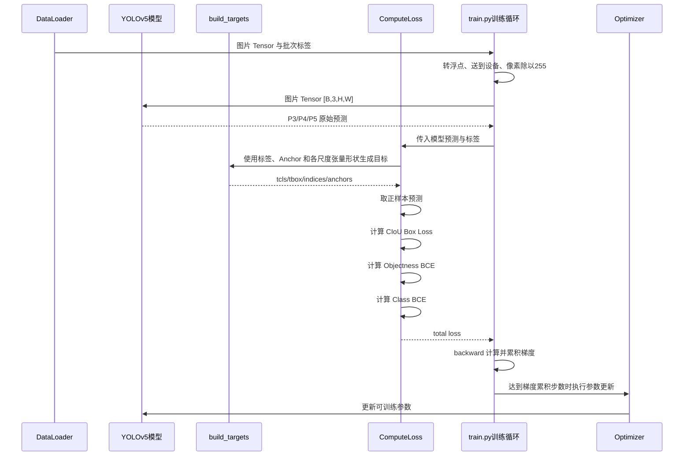

具体可以分成 8 步：

1. 检测 DataLoader 读取图片和标签、组织缩放与数据增强，把图像转为通道在前的 Tensor，并整理批次标签；`train.py` 再把图像送到设备、转浮点并除以 255，将像素缩放到 0～1。
2. 图片进入模型，得到 P3/P4/P5 三个检测尺度的原始预测张量。
3. `build_targets()` 把真实框复制到各 Anchor，并根据宽高比例筛选匹配项。
4. 对靠近网格边界的目标增加合法邻居网格偏移。
5. 根据 `indices` 从预测张量中取出正样本预测。
6. 计算 Box、Objectness、Class 三类损失。
7. 按 `hyp` 中的 `box`、`obj`、`cls` 权重合成 total loss。
8. 训练循环在 AMP 启用时先缩放 loss 再反向传播，计算并累积梯度；达到当前累积步数后，由优化器更新模型参数、清空梯度并更新 EMA。

每次参数更新后，后续批次会使用更新的模型继续预测。经过很多 batch 和 epoch 后，模型逐渐学会：哪些纹理像目标、目标中心在哪里、目标有多大、目标属于哪个类别。

### 3.2.25 如何阅读训练日志中的三种 loss

训练时常见输出类似：

```text
box_loss  obj_loss  cls_loss  Instances  Size
0.081     0.042     0.013     16         640
```

不要只看某一项是否单调下降，而要结合验证集指标判断：

| 日志项 | 它主要反映什么 | 过高或异常时可检查什么 |
|---|---|---|
| `box_loss` | 正样本框的位置、大小和形状回归 | 标签框是否准确、目标尺寸是否极端、输入分辨率是否合适 |
| `obj_loss` | 目标/背景判断和候选框质量 | 背景是否复杂、正负样本是否失衡、Anchor/检测尺度是否适配 |
| `cls_loss` | 正样本类别区分 | 类别是否混淆、类别标注是否错误、类别数量是否配置正确 |

几个重要判断：

- loss 降低通常是好现象，但不等于验证集 mAP 一定提高。
- `cls_loss` 很低不等于类别识别一定可靠；如果类别极不平衡，仍要看每类 Precision/Recall。
- `obj_loss` 很低但验证集 Recall 很差，可能是模型过于保守，也可能是标签或阈值设置有问题。
- 训练 loss 很低、验证 mAP 变差，常见原因之一是过拟合，应结合数据量、增强、epoch 和验证曲线判断。

真正判断模型是否学会，至少要同时看：`box_loss`、`obj_loss`、`cls_loss`、验证集 Precision、Recall、mAP，以及预测可视化结果。

### 3.2.26 标签匹配和损失函数的常见误区

| 误区 | 正确理解 |
|---|---|
| “每个真实框只对应一个 Anchor” | 一个真实框可能匹配多个 Anchor、多个尺度，边界附近还可能增加邻居网格 |
| “BPR 就是模型 Recall” | BPR 只是 Anchor 几何匹配的理论覆盖率，不是验证集召回率 |
| “Box Loss 只看中心点距离” | 本仓库使用 CIoU，综合考虑重叠、中心距离和长宽比 |
| “没有真实框的位置完全不参与损失” | 背景位置会参与 Objectness Loss，目标为 0 |
| “Class Loss 对所有网格都计算” | 本项目只对正样本计算类别损失 |
| “loss 越低 mAP 一定越高” | loss 和 mAP 衡量角度不同，必须结合验证结果 |
| “AutoAnchor 运行后会永久改 YAML” | 它通常只修改本次训练内存中的模型，原 YAML 不会自动改写 |
| “只要换更大的 n/s/m/l/x 模型就能解决问题” | 数据标签、匹配、输入分辨率和检测尺度同样重要 |

### 3.2.27 与本仓库源码的精确对应关系

| 学习内容 | 文件 | 重点代码 |
|---|---|---|
| 训练循环怎样调用损失 | `train.py` | `pred = model(imgs)`、`loss, loss_items = compute_loss(pred, targets)`、`loss.backward()` |
| 损失对象如何初始化 | `utils/loss.py` | `ComputeLoss.__init__()`、BCE、label smoothing、Focal Loss、尺度 balance |
| 标签怎样匹配 Anchor | `utils/loss.py` | `ComputeLoss.build_targets()` |
| 框损失怎样计算 | `utils/loss.py` | `bbox_iou(..., CIoU=True)`、`lbox += (1.0 - iou).mean()` |
| Objectness 目标怎样生成 | `utils/loss.py` | `tobj` 初始化、默认将正样本的 CIoU 停止梯度并截断负值后写入 |
| 类别目标怎样生成 | `utils/loss.py` | `self.cp/self.cn`、`self.BCEcls(pcls, t)` |
| 预测张量怎样被 Detect 生成 | `models/yolo.py` | `Detect.forward()`、`self.no=nc+5`、三尺度输出 |
| Anchor 预检查与重算 | `utils/autoanchor.py` | `check_anchors()`、`kmean_anchors()` |

建议实际阅读源码时，按这个顺序做“对照阅读”：

```text
train.py 的 Forward/ComputeLoss
        ↓
utils/loss.py 的 __call__()
        ↓
utils/loss.py 的 build_targets()
        ↓
models/yolo.py 的 Detect.forward()
        ↓
utils/metrics.py 的 bbox_iou()
```

当你能回答下面三个问题时，说明已经真正理解了 YOLOv5 的学习机制：

1. 一个标签框为什么会被分配给某个尺度、某个 Anchor、某个网格位置？
2. 这个正样本的 `x/y/w/h`、objectness 和类别分别拿什么目标来比较？
3. total loss 的梯度最终怎样回到 Backbone、Neck 和 Head 的卷积参数？

### 3.2.28 图解：把模型结构、标签匹配和梯度连接起来

下面这张图把前面分散讲过的知识合并成一条主线：左侧是输入和特征提取，中间是 P3/P4/P5 三个检测尺度，右侧是标签匹配、三类损失和参数更新。

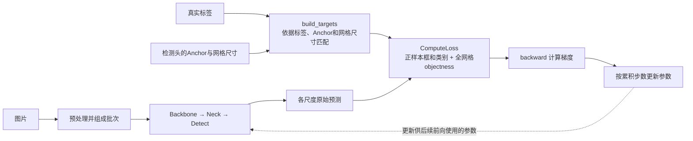

真实标签进入匹配与损失计算；Backbone 的图像输入不包含标签。这里的匹配依据是标注框与 Anchor 的宽高比例及网格位置，不按当前预测分数选负责人。三尺度原始预测同时进入损失计算，不能只画出“匹配结果→损失”而省略预测数据。

阅读这张图时，可以沿两个方向看：

```text
前向方向：输入 → Backbone → Neck → P3/P4/P5 → 预测
学习方向：预测 + 标签 → build_targets → Loss → 梯度 → 更新参数
```

这两个方向共同构成一次训练。只有前向传播，模型只是在“做题”；只有标签而没有前向预测，模型也无法知道自己错在哪里；只有把损失反向传播回卷积参数，模型才会在下一批数据上做出不同的预测。

### 3.2.29 用代码查看 YOLOv5 的真实网络结构

#### 示例一：打印 YAML 构建出来的每一层

下面的代码可以放在仓库根目录中运行。它不训练模型，只是读取 `models/yolov5s.yaml`，构建一个 2 类模型，然后打印模型实际生成的层。

```python
# inspect_yolov5_model.py
import torch

from models.common import C3
from models.yolo import Model


# nc=2 会覆盖 YAML 中的默认类别数，便于观察自定义数据集模型
model = Model("models/yolov5s.yaml", ch=3, nc=2)

print("类别数:", model.yaml["nc"])
print("检测层 stride:", model.stride.tolist())
print("模型层数:", len(model.model))
print()

for i, layer in enumerate(model.model):
    from_layer = getattr(layer, "f", "?")
    if isinstance(layer, C3):
        repeat_info = f"C3内部Bottleneck={len(layer.m)}"
    elif isinstance(layer, torch.nn.Sequential):
        repeat_info = f"外部串联模块={len(layer)}（需对照模块类型）"
    else:
        repeat_info = "外部模块=1"
    params = sum(p.numel() for p in layer.parameters())
    print(
        f"{i:>2} | "
        f"from={str(from_layer):>8} | "
        f"{repeat_info} | "
        f"params={params:>10,} | "
        f"{layer.__class__.__name__}"
    )
```

这段代码与 YAML 的对应关系是：

| 代码输出 | YAML 中的概念 | 解释 |
|---|---|---|
| `i` | 层编号 | 例如第 0 层、第 4 层、第 24 层 |
| `from` | `from` 字段 | 当前层从哪一层取输入，`-1` 表示上一层 |
| `C3内部Bottleneck` | C3 行的 `number` 经深度缩放后的结果 | 从实际 `layer.m` 序列读取；外部仍是一个 C3 |
| `外部串联模块` | 当前外层 `nn.Sequential` 的子模块数 | 应结合模块类型判断，不能直接当成 C3 内部重复数 |
| `params` | 参数数量 | 通道数越多、模块越深，通常参数越多 |
| 类名 | `module` 字段 | 如 `Conv`、`C3`、`SPPF`、`Detect` |

注意：本地解析器没有统一设置 `layer.n` 属性，因此不能用它读取重复次数。上例针对标准 `yolov5s.yaml`；其四个 Backbone C3 的内部 Bottleneck 数应为 `[1,2,3,1]`，融合部分四个 C3 内部均为 1。`depth_multiple` 控制这些数量，`width_multiple` 控制通道数；顶部打印的 25 是 YAML 外层模块条目数，包含 Concat、Upsample、Detect 等，不是卷积层总数。

#### 示例二：查看三个检测输出的张量形状

训练模式下，`Detect.forward()` 会返回三个尺度的预测张量。下面用 2 类、640×640 输入来观察形状：

```python
import torch

from models.yolo import Model


model = Model("models/yolov5s.yaml", ch=3, nc=2)
model.train()  # 训练模式下，Detect 返回各尺度的原始预测列表

images = torch.zeros(1, 3, 640, 640)
with torch.no_grad():
    predictions = model(images)

for scale, prediction in enumerate(predictions):
    print(f"P{scale + 3}: {tuple(prediction.shape)}")
```

预期形状可以按下面方式理解：

```text
P3: (1, 3, 80, 80, 7)
P4: (1, 3, 40, 40, 7)
P5: (1, 3, 20, 20, 7)
```

这里的最后一维 `7` 来自：

```text
5 + nc = 5 + 2 = 7
```

其中 5 表示 `x、y、w、h、objectness`，2 表示两个类别。对于 COCO 的 80 类，最后一维会变成 `85`。

#### 示例三：用 forward hook 观察中间特征图

如果你不想只看最终 Detect 输出，可以用 PyTorch 的 forward hook 暂时记录中间层输出：

```python
import torch

from models.yolo import Model


model = Model("models/yolov5s.yaml", ch=3, nc=2).eval()
feature_maps = {}
handles = []


def save_feature(name):
    def hook(module, inputs, output):
        if isinstance(output, torch.Tensor):
            feature_maps[name] = tuple(output.shape)
        else:
            feature_maps[name] = type(output).__name__

    return hook


# 这些编号对应标准 yolov5s.yaml 中的关键层
for layer_index in (0, 4, 6, 9, 17, 20, 23):
    handle = model.model[layer_index].register_forward_hook(
        save_feature(f"layer_{layer_index}")
    )
    handles.append(handle)

with torch.no_grad():
    model(torch.zeros(1, 3, 640, 640))

for name, shape in feature_maps.items():
    print(name, shape)

# hook 用完后要移除，避免长期运行时重复记录
for handle in handles:
    handle.remove()
```

这段代码能帮助你建立“层编号—特征图尺寸—模型功能”的对应关系：

```text
layer 0  → 输入 stem，空间尺寸开始减半
layer 4  → P3 附近的高分辨率特征
layer 6  → P4 附近的中分辨率特征
layer 9  → SPPF 后的深层语义特征
layer 17 → P3 检测输入
layer 20 → P4 检测输入
layer 23 → P5 检测输入
```

不同 YAML 或本地改进模型的层编号可能不同，所以阅读自定义模型时应先查看对应 YAML，而不能盲目复制这些编号。

#### 示例四：直接观察 `build_targets()` 产生了多少正样本

如果你想理解“一个 batch 的真实框到底被分配给了哪些网格”，可以单独调用 `build_targets()`。下面是教学用示例：

```python
import torch

from models.yolo import Model
from utils.loss import ComputeLoss


model = Model("models/yolov5s.yaml", ch=3, nc=2).train()

# ComputeLoss 需要这些超参数；正式训练时它们来自 data/hyps/*.yaml
model.hyp = {
    "cls_pw": 1.0,
    "obj_pw": 1.0,
    "label_smoothing": 0.0,
    "fl_gamma": 0.0,
    "anchor_t": 4.0,
    "box": 0.05,
    "obj": 1.0,
    "cls": 0.5,
}

images = torch.zeros(1, 3, 640, 640)
targets = torch.tensor(
    [[0, 1, 0.53, 0.47, 0.10, 0.20]],
    dtype=torch.float32,
)

with torch.no_grad():
    predictions = model(images)

compute_loss = ComputeLoss(model)
tcls, tbox, indices, anchors = compute_loss.build_targets(
    predictions, targets
)

for i, (cls_i, box_i, index_i, anchor_i) in enumerate(
    zip(tcls, tbox, indices, anchors)
):
    b, a, gj, gi = index_i
    print(f"P{i + 3}: 正样本数量={len(b)}")
    print("  image index:", b.tolist())
    print("  anchor index:", a.tolist())
    print("  grid x/y:", list(zip(gi.tolist(), gj.tolist())))
    print("  local box:", box_i.tolist())
    print("  anchor wh:", anchor_i.tolist())
```

这个示例最值得观察的不是具体数字，而是返回值的角色：

```text
tcls    告诉 Class Loss：正样本应该属于哪个类别
tbox    告诉 Box Loss：框在网格内的中心和网格尺度宽高是多少
indices 告诉程序：去预测张量的哪个位置取预测值
anchors 告诉 Box Loss：这个正样本使用哪个 Anchor 解码宽高
```

### 3.2.30 代码级别追踪一次预测张量

从 `models/yolo.py` 可以把检测头的核心逻辑压缩成下面这段伪代码：

```python
# x[i] 是第 i 个检测尺度的特征图
for i in range(number_of_detection_layers):
    raw = output_conv[i](x[i])

    # [B, na * (nc + 5), H, W]
    raw = raw.view(batch, na, nc + 5, height, width)

    # [B, na, H, W, nc + 5]
    raw = raw.permute(0, 1, 3, 4, 2)

    if inference:
        xy, wh, conf = raw.sigmoid().split((2, 2, nc + 1), dim=-1)
        # 源码 _make_grid() 中的 grid 已是“整数网格索引 - 0.5”
        xy = (xy * 2 + grid) * stride
        wh = (wh * 2) ** 2 * anchor_grid
        decoded = concat(xy, wh, conf)
```

训练模式和推理模式的区别：

| 模式 | Detect 输出 | 主要用途 |
|---|---|---|
| 训练模式 | 保留各尺度的原始 logits | `ComputeLoss` 需要原始预测来计算梯度 |
| 推理模式 | 解码成网络输入图坐标并拼接候选框；普通非导出模式还返回原始预测 | 后续筛选与 NMS，再由推理入口还原到原图坐标 |

这也解释了为什么训练代码和 `detect.py` 中看到的输出形式不完全一样：它们处于不同阶段。训练时不能过早把所有信息处理成最终框，否则损失函数需要的梯度路径可能会被破坏。

### 3.3 本地改进模型 YAML

| 文件 | 设计意图 |
|---|---|
| `yolov5s-C3GC-B.yaml` | 在 Backbone 使用 C3GC 全局上下文模块。 |
| `yolov5s-C3GC-BH.yaml` | Backbone 和 Head 都使用 C3GC。 |
| `yolov5s-C3GC-E.yaml` | 加入 P2 小目标检测尺度，输出 P2/P3/P4。 |
| `yolov5s-C3GC-P.yaml` | P2 小目标检测 + Head 中的 C3GC。 |
| `yolov5P2-CBAM.yaml` | 设计为 P2/P3/P4/P5 四尺度 + CBAM 注意力。当前源码未找到 `CBAM` 实现，因此该配置不能直接保证可用。 |

### 3.4 `models/hub/`：上游或实验模型配置

| 文件 | 作用 |
|---|---|
| `anchors.yaml` | Anchor 参考定义。 |
| `yolov3.yaml`、`yolov3-tiny.yaml`、`yolov3-spp.yaml` | YOLOv3 兼容配置。 |
| `yolov5-fpn.yaml` | FPN 特征融合结构。 |
| `yolov5-panet.yaml` | PANet 特征融合结构。 |
| `yolov5-bifpn.yaml` | 通过额外连接进行 BiFPN 风格融合。 |
| `yolov5-p2.yaml` | 包含 P2 小目标检测层。 |
| `yolov5-p34.yaml` | 只输出 P3/P4 两层结果。 |
| `yolov5-p6.yaml`、`yolov5-p7.yaml` | 更深/更多尺度的模型。 |
| `yolov5n6.yaml`、`yolov5s6.yaml`、`yolov5m6.yaml`、`yolov5l6.yaml`、`yolov5x6.yaml` | P6 系列的不同规模版本。 |
| `yolov5s-ghost.yaml` | Ghost 卷积/模块变体。 |
| `yolov5s-transformer.yaml` | Transformer 变体。 |
| `yolov5s-LeakyReLU.yaml` | LeakyReLU 激活函数变体。 |

### 3.5 `models/segment/`：分割模型 YAML

- `yolov5n-seg.yaml`
- `yolov5s-seg.yaml`
- `yolov5m-seg.yaml`
- `yolov5l-seg.yaml`
- `yolov5x-seg.yaml`

它们分别对应 n/s/m/l/x 五种规模。与检测模型相比，最后一层由 `Detect` 改成 `Segment`，除边界框外还输出实例掩码相关张量。

## 4. `utils/`：训练、推理与部署的公共能力

### 4.1 核心工具文件

| 文件 | 主要职责 |
|---|---|
| `general.py` | 全局常量、日志、文件检查、数据集检查、YAML 读写、下载、坐标转换、NMS、路径递增、图片读写等。 |
| `dataloaders.py` | 图片/视频/摄像头/流加载；检测训练集 `LoadImagesAndLabels`；`load_mosaic()` 等 Mosaic 拼图实现与增强流程组织；分类训练集；检测和分类 DataLoader 工厂。 |
| `augmentations.py` | Letterbox、HSV、随机透视、MixUp、Copy-Paste、Albumentations、分类增强等具体变换；Mosaic 拼图主体位于 `dataloaders.py`。 |
| `loss.py` | 检测框、目标置信度、类别损失；BCE、Focal Loss、QFocal Loss。 |
| `metrics.py` | IoU、AP、mAP、混淆矩阵、PR/F1/P/R 曲线计算。 |
| `plots.py` | 标签分布、训练 Mosaic、验证预测、学习率、结果曲线、特征图可视化。 |
| `torch_utils.py` | 设备选择、DDP、AMP、EMA、Early Stopping、优化器、模型融合、参数与 FLOPs 统计。 |
| `autoanchor.py` | AutoAnchor 实现：评估 BPR/AAT、检查 Anchor 顺序、K-means 初始化、遗传算法微调，以及必要时替换本次训练模型的 Anchor；详见 3.2.13。 |
| `autobatch.py` | 自动探测适合显存的 batch size。 |
| `callbacks.py` | 训练和验证生命周期回调注册与触发。 |
| `downloads.py` | URL 检查、下载、权重自动下载。 |
| `activations.py` | SiLU、Mish、FReLU、AconC 等可选激活函数。 |
| `triton.py` | Triton Inference Server 远程模型调用。 |
| `test.py` | 极小的辅助测试文件。 |
| `__init__.py` | 异常包装、线程工具、Notebook 初始化。 |

### 4.2 `utils/segment/`：分割专用工具

| 文件 | 主要职责 |
|---|---|
| `dataloaders.py` | 读取 polygon 标注，生成训练所需 mask。 |
| `augmentations.py` | 图片与 mask 的同步 MixUp、透视增强。 |
| `loss.py` | 检测损失与掩码损失。 |
| `metrics.py` | Box AP、Mask AP 和对应 fitness。 |
| `general.py` | 掩码裁剪、上采样、缩放、Mask IoU、mask 转轮廓。 |
| `plots.py` | 绘制带预测或标签掩码的图片与结果曲线。 |
| `__init__.py` | 包标记。 |

### 4.3 `utils/loggers/`：实验记录

| 位置 | 作用 |
|---|---|
| `loggers/__init__.py` | 总日志管理：CSV、TensorBoard、W&B、ClearML、Comet。 |
| `loggers/wandb/wandb_utils.py` | Weights & Biases 集成。 |
| `loggers/clearml/clearml_utils.py` | ClearML 集成。 |
| `loggers/clearml/hpo.py` | ClearML 超参数优化。 |
| `loggers/comet/__init__.py` | Comet ML 日志实现。 |
| `loggers/comet/comet_utils.py` | Comet 权重下载、恢复训练等工具。 |
| `loggers/comet/hpo.py` | Comet 超参数优化。 |
| `loggers/comet/optimizer_config.json` | Comet 优化器配置。 |
| `loggers/*/README.md` | 对应第三方日志平台的接入说明。 |

### 4.4 部署和云平台辅助目录

```text
utils/
├─ aws/
│  ├─ resume.py             AWS 环境恢复训练
│  ├─ userdata.sh           AWS 实例启动脚本
│  └─ mime.sh               MIME 配置脚本
├─ docker/
│  ├─ Dockerfile            默认容器环境
│  ├─ Dockerfile-cpu        CPU 容器环境
│  └─ Dockerfile-arm64      ARM64 容器环境
├─ flask_rest_api/
│  ├─ restapi.py            Flask 目标检测 HTTP 服务
│  ├─ example_request.py    API 请求示例
│  └─ README.md             API 使用说明
└─ google_app_engine/
   ├─ app.yaml              Google App Engine 配置
   ├─ Dockerfile            云端容器配置
   └─ additional_requirements.txt  云端额外依赖
```

## 5. `data/`：数据集、超参数与数据准备

### 5.1 数据集 YAML

| 文件 | 数据集或任务 |
|---|---|
| `coco.yaml` | COCO 2017，80 类检测。 |
| `coco128.yaml` | COCO 的 128 图像小型测试集。 |
| `coco128-seg.yaml` | COCO128 实例分割版本。 |
| `VOC.yaml` | PASCAL VOC，20 类检测；内含下载与 XML 转 YOLO 的脚本。 |
| `VisDrone.yaml` | VisDrone，无人机视角 10 类目标检测。 |
| `dfire.yaml` | DFire，`smoke` 与 `fire` 两类。 |
| `Mydata.yaml` | 自定义枪械数据集：ak47、m4a1、m4a4、awp。 |
| `Argoverse.yaml` | Argoverse 自动驾驶数据集。 |
| `GlobalWheat2020.yaml` | 全球小麦检测。 |
| `ImageNet.yaml` | ImageNet 分类。 |
| `ImageNet10.yaml` | ImageNet 10 类子集。 |
| `ImageNet100.yaml` | ImageNet 100 类子集。 |
| `ImageNet1000.yaml` | ImageNet 1000 类。 |
| `Objects365.yaml` | Objects365 检测。 |
| `SKU-110K.yaml` | 密集货架商品检测。 |
| `xView.yaml` | 遥感目标检测。 |

### 5.2 `data/hyps/`：超参数配置

| 文件 | 用途 |
|---|---|
| `hyp.scratch-low.yaml` | 小型模型从零训练。 |
| `hyp.scratch-med.yaml` | 中型模型从零训练。 |
| `hyp.scratch-high.yaml` | 大型模型从零训练。 |
| `hyp.dfire.yaml` | 为火焰、烟雾和无人机视角调整过的增强/优化参数。 |
| `hyp.no-augmentation.yaml` | 关闭 YOLOv5 内建几何与颜色增强。 |
| `hyp.VOC.yaml` | VOC 参数预设。 |
| `hyp.Objects365.yaml` | Objects365 参数预设。 |
| `hyp.person.yaml` | 面向 person 类检测的参数预设。 |

### 5.3 `data/scripts/`：数据准备脚本

- `download_weights.sh`：下载官方权重。
- `get_coco.sh`、`get_coco128.sh`：下载 COCO/COCO128。
- `get_imagenet.sh`、`get_imagenet10.sh`、`get_imagenet100.sh`、`get_imagenet1000.sh`：下载或整理 ImageNet 数据。

### 5.4 `data/tricks/`：本地网络改进

- `C3GC.py`：自定义全局上下文模块。
  - `CB2d`：通过注意力池化得到全局上下文，并执行通道乘法/加法增强。
  - `C3GC`：将 `CB2d` 融入 C3 风格双分支结构。
  - `GCBottleneck`：带上下文增强的 Bottleneck。
- `C3GC.txt`：该模块的文本备份。

## 6. `classify/`：图像分类任务

| 文件 | 作用 |
|---|---|
| `train.py` | 分类训练。可加载 YOLOv5 分类权重、把检测模型转换为分类模型，也支持 torchvision 模型。 |
| `predict.py` | 分类推理，输出每张图的 Top 类别及置信度。 |
| `val.py` | 分类验证，计算 Top-1、Top-5 准确率。 |
| `tutorial.ipynb` | 分类任务教程。 |

分类数据目录通常是：

```text
dataset/
├─ train/
│  ├─ class_a/
│  └─ class_b/
└─ val/
   ├─ class_a/
   └─ class_b/
```

## 7. `segment/`：实例分割任务

| 文件 | 作用 |
|---|---|
| `train.py` | 分割训练；在检测训练流程上增加 mask 数据、mask loss、mask 指标。 |
| `predict.py` | 分割推理；输出边界框、类别、置信度和实例掩码。 |
| `val.py` | 分割验证；分别统计 Box 和 Mask 的指标。 |
| `tutorial.ipynb` | 分割教程。 |

## 8. `weights/`：本地权重库

截至 2026-10-21，当前目录中有下列权重文件。用途分组沿用本地命名与项目说明；文件名不能单独证明其训练数据、类别顺序或精度，实际使用前仍需核对模型元数据与验证结果。

```text
weights/
├─ Fire0.pt、Fire1s.pt、Firev5s.pt、dfire_v2.pt
│  火焰/烟雾相关权重
├─ Drone.pt、Drone-best.pt、Drone-exe.pt、Drone2.pt
├─ Drone2_fix.pt、Drone3.pt
│  无人机检测及跨平台修复权重
├─ ent_v4.pt
│  ent 系列本地权重
└─ swim.pt
   其他自定义任务权重
```

历史说明中还出现过 `ent_v1.pt`、`ent_v2.pt`、`ent_v3-old.pt`、`ent_v3.pt`，本次核对时这些文件不在当前 `weights/` 中。`Drone2_fix.pt` 的命名与 `convert_model.py` 的默认输出相符，但本次未加载权重核实其来源。

## 9. `runs/`：实验过程与结果

`runs/` 是程序默认使用的输出目录，目前本地不存在。下图介绍运行后可能生成的结构，不代表这些产物已在当前目录中。传入 `--project` 时，输出根目录可以改变；标签与裁剪图片还分别取决于 `--save-txt`、`--save-crop` 等选项。

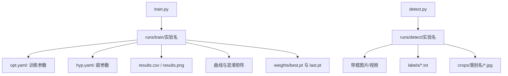

### 历史说明中记录的训练实验（当前无法从目录核实）

以下名称保留作历史索引。当前没有 `runs/train/`，因此不能据此断言实验文件仍存在，也无法仅凭本目录核实实验配置和结果：

- `dfire_baseline_autobatch`：DFire 基线实验。
- `dfire_planA_autobatch` 至 `dfire_planE_autobatch`：多套改进结构对照实验。
- `dfire_planB-P2_autobatch`、`dfire_PlanD-P2_autobatch`：P2 小目标检测实验。
- `dfire_v2`：DFire 第二版实验。
- `entv2`、`iot.cnovit.com/202607271146/entv4`：自定义 ent 数据集实验。
- `retrainFire`：火灾模型再训练相关目录。

启用相应保存与绘图选项时，一次训练的输出通常包括下列文件；具体结果取决于运行参数：

| 文件类型 | 含义 |
|---|---|
| `opt.yaml` | 启动训练时的命令行参数快照。 |
| `hyp.yaml` | 实际使用的超参数。 |
| `results.csv` | 每个 epoch 的损失、P、R、mAP、学习率。 |
| `results.png` | `results.csv` 的曲线图。 |
| `confusion_matrix.png` | 类别混淆矩阵。 |
| `P_curve.png`、`R_curve.png`、`PR_curve.png`、`F1_curve.png` | 验证指标曲线。 |
| `train_batch*.jpg` | 训练批次可视化；是否呈现 Mosaic 取决于增强配置。 |
| `val_batch*_labels.jpg` | 验证集真实标签图。 |
| `val_batch*_pred.jpg` | 验证集预测结果图。 |
| `weights/best.pt` | 验证指标最佳的权重。 |
| `weights/last.pt` | 最近一次已保存 epoch 的检查点；训练正常结束后会清理优化器等状态。 |

### 历史说明中记录的推理批次（当前无法从目录核实）

当前没有 `runs/detect/`；下列名称是历史记录，不是当前文件清单：

- `Dfirev2`、`Firev5s`：火焰/烟雾模型推理。
- `test0828-v7`、`test0828-v9`：大批量检测结果。
- `exp`、`smoke`、`swim`、`test0827`：其他测试批次。

## 10. `testdata/`、开发工具与缓存目录

| 目录 | 内容 |
|---|---|
| `testdata/` | 当前不存在。可自行建立作为批量推理输入目录；历史说明曾记载 688 张 JPG，本次无法核实数量和标注状态。 |
| `.cometml-runs/` | Comet ML 离线实验记录压缩包。 |
| `.idea/` | PyCharm/JetBrains 项目配置。 |
| `.vscode/` | VS Code 项目设置。 |
| `__pycache__/` | Python 自动生成的字节码缓存，可删除后自动重建。 |
| `assets/` | 当前存在，包含本文引用的训练结构示意图。 |
| `output/`、`tmp/` | 当前存在的本地输出、临时工作目录；应查看内容后判断用途。 |

## 11. 检测训练、验证、推理分别发生什么

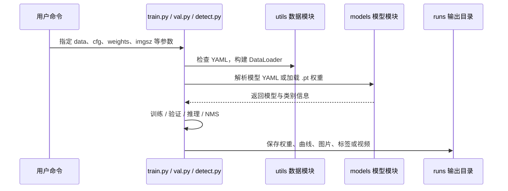

## 12. 当前项目的结构性注意事项

1. 当前目录没有可用的 `.git` 工作树信息，不能依赖 Git 历史追踪本地改动。
2. 旧版文档曾记录历史实验引用 `models/PlanA5s.yaml`、`models/PlanD5s-P2.yaml`、`data/ent.yaml`，这些文件目前缺失，`runs/train/` 也不存在；本次只能确认路径缺失，无法复核原始实验记录，不能据此完整复现实验。
3. `train.py` 当前默认组合为 `yolov5s-fire.yaml`、`VisDrone.yaml`、`hyp.dfire.yaml`，这是本地实验残留组合，实际训练时应显式传入匹配的 `--cfg --data --hyp`。
4. `detect.py` 默认权重和输入视频是硬编码的本机路径，换机器或换目录时应显式传入 `--weights` 与 `--source`。
5. `models/yolov5P2-CBAM.yaml` 使用 `CBAM`，但当前代码库没有它的实现或注册；使用前需要补齐模块。
6. `models/common.py` 在缺少 `ultralytics` 包时可能尝试自动安装依赖；生产环境更适合提前通过 `requirements.txt` 安装。
7. 项目没有完整独立的 `tests/` 目录，当前更依赖训练结果、Notebook 和命令行脚本验证。

## 13. 推荐阅读顺序

如果目标是理解核心检测链路，按以下顺序阅读最有效：

1. `detect.py`：先看一次推理从输入到输出。
2. `train.py`：理解训练参数、训练循环、验证和权重保存。
3. `models/yolo.py`：理解 YAML 如何生成网络。
4. `models/common.py`：理解 Conv、C3、SPPF、DetectMultiBackend。
5. `utils/dataloaders.py`：理解图片与标签如何进入模型。
6. `utils/loss.py` 和 `utils/metrics.py`：理解训练目标与评价指标。
7. `data/tricks/C3GC.py`：理解本项目相对标准 YOLOv5 的核心结构改进。

## 14. 新手最应该先看懂的四个文件

如果你是第一次接触这个仓库，不建议一开始就阅读一千多行的工具文件。可以先看下面四个文件：

### `detect.py`：模型怎样做一次预测

它的工作可以拆成六步：

1. 读取命令行参数，例如权重路径和图片路径。
2. 选择 CPU 或 GPU。
3. 使用 `DetectMultiBackend` 加载权重。
4. 使用 `LoadImages`、`LoadStreams` 或 `LoadScreenshots` 读取输入。
5. 把图片缩放、转成 Tensor、归一化到 `0～1`。
6. 模型预测后执行 NMS，并将结果保存到 `runs/detect/`。

它不会让模型学习，只是使用已经训练好的权重。

### `train.py`：模型怎样学习

训练循环按 batch（一次处理的一组图片）计算损失，在 epoch（一轮训练数据遍历）结束后验证并保存。以下按默认的验证、保存行为示意，实际还受 `--noval`、`--nosave`、早停等选项控制：

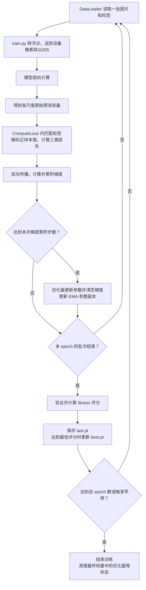

前向输出此时包含框和分数的原始预测值；损失函数取出正样本并进行所需变换。它与推理阶段经过解码、置信度筛选、NMS 的最终框处于不同处理阶段。梯度累积表示先把若干批次的梯度累加，再执行一次参数更新；EMA 是训练参数的滑动平均副本。

其中：

- `epoch`：完整看完一遍训练集。
- `batch`：一次送进 CPU 或 GPU 的一组图片；`batch size` 是这组图片的数量。
- `loss`：预测错误程度，通常越低越好。
- `optimizer`：根据误差调整模型参数的方法。
- `best.pt`：当前验证 fitness 评分达到最佳时保存的权重。检测任务的默认评分是 `0.1×mAP@0.5+0.9×mAP@0.5:0.95`，见 `utils/metrics.py` 的 `fitness()`。
- `last.pt`：最近一个已保存 epoch 的检查点。中断训练时可用于恢复到该 epoch 之后；正常训练结束后，其优化器等状态会被清理，详见第 17、18 节。

### `models/yolo.py`：YAML 怎样变成网络

模型 YAML 中的每一行通常是：

```text
[from, number, module, args]
```

例如：

```yaml
[-1, 1, Conv, [128, 3, 2]]
```

可以理解为：

| 字段 | 含义 |
|---|---|
| `-1` | 输入来自上一层。 |
| `1` | 重复 1 次。 |
| `Conv` | 使用卷积模块。 |
| `[128, 3, 2]` | 输出通道 128、卷积核 3、步幅 2。 |

`parse_model()` 会依次读取这些配置，创建真正的 `nn.Module`，最后组合成完整模型。

### `utils/dataloaders.py`：图片怎样进入模型

它负责：

- 查找图片文件。
- 根据图片名称寻找同名标签。
- 读取图片并转换颜色通道。
- Resize、Letterbox、Mosaic 等预处理。
- 将标签从文本格式转换为 Tensor。
- 按 batch 提供给训练或验证代码。

如果训练时报“找不到图片”“找不到标签”或“标签格式错误”，通常优先检查这个环节和数据集目录。

## 15. 模型配置文件到底决定什么

一个模型 YAML 主要包含以下六组配置：

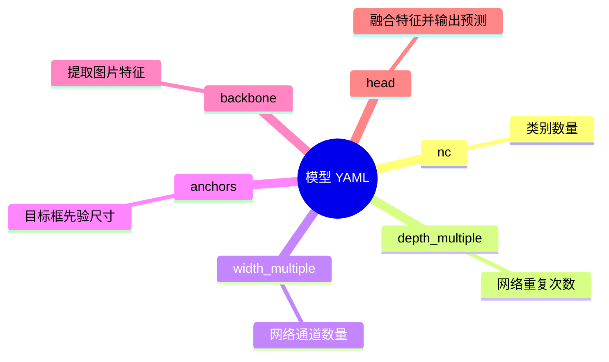

### Backbone 是什么

Backbone 可以理解为“看图并提取特征”的部分。浅层通常学习边缘、颜色和纹理，深层学习更抽象的目标形状和语义。

### Head 是什么

Head 根据 Backbone 提取的特征输出检测结果。YOLOv5 通常同时使用多个尺度：

| 检测层 | 适合目标 |
|---|---|
| P2 | 很小的目标。 |
| P3 | 小目标。 |
| P4 | 中等目标。 |
| P5 | 大目标。 |

本项目中的 E/P 和 P2 配置增加了 P2 检测层，目标是改善无人机视角或远距离小目标检测效果。

### `nc` 为什么重要

`nc` 是类别数。例如：

- COCO：80 类。
- VisDrone：10 类。
- DFire：2 类。
- Mydata：4 类。

需要按使用场景区分：

- **直接推理或验证已有模型**：模型输出类别数、类别编号及名称的含义应与任务一致。例如 `0=smoke` 的模型不能因为换了一份 YAML，就把原来的第 0 类当成 `pedestrian`。
- **迁移学习或微调**：预训练权重可以来自不同类别数的任务，例如用 COCO 80 类权重初始化 DFire 2 类模型。`train.py` 按数据集类别数构建目标模型，再通过 `intersect_dicts()` 加载名称与形状匹配的参数；不匹配的检测头参数保留新初始化值，并按条件排除 Anchor 参数。

因此应检查实际构建的类别数、类别顺序与参数迁移日志；不能一概要求“预训练权重的类别数必须等于新数据集类别数”。

## 16. 训练结果文件怎么读

训练完成后，优先查看以下文件：

| 文件 | 先看什么 |
|---|---|
| `results.png` | Loss 是否下降，Precision/Recall/mAP 是否趋于稳定。 |
| `results.csv` | 逐 epoch 的原始数值。 |
| `confusion_matrix.png` | 哪些类别容易相互误判。 |
| `PR_curve.png` | 置信度变化时 Precision 和 Recall 的平衡。 |
| `F1_curve.png` | 哪个置信度阈值附近的综合效果较好。 |
| `val_batch*_pred.jpg` | 模型实际框得是否准确。 |
| `weights/best.pt` | 通常优先用于实际推理。 |
| `weights/last.pt` | 最近一次保存的权重；用于检查末期状态。能否断点续训还取决于 epoch、优化器等训练状态是否保留。 |

需要注意：最后一个 epoch 的结果不一定是最好的，因此实际部署通常选择 `best.pt`，而不是自动选择 `last.pt`。

## 17. 常用命令的含义

下面的命令均假设终端工作目录为仓库根目录。输入图片目录、数据集与权重必须事先准备好；这些命令是使用示例，不代表本地训练数据和运行环境已完整验证。

### 检测推理

```powershell
python detect.py --weights weights\Firev5s.pt --source "D:\你的图片目录" --conf-thres 0.25
```

含义：用 `Firev5s.pt` 读取指定目录的图片，预测结果保存到 `runs/detect/exp` 或自动递增的目录。请将 `D:\你的图片目录` 替换为真实目录；当前仓库没有 `testdata/`。

### 检测验证

```powershell
python val.py --weights weights\dfire_v2.pt --data data\dfire.yaml --imgsz 640
```

含义：在 DFire 验证集上评估 `dfire_v2.pt`。当前 `data/dfire.yaml` 中的 `path: ./datasets/dfire` 会由 `check_dataset()` 相对于仓库根目录解析，因此需要准备 `yolov5-master/datasets/dfire/val/images` 及对应标签，或将 YAML 的 `path` 改为真实数据集路径。

### 从已有权重初始化训练（微调）

微调是在已有参数基础上开展一次训练。下面的 `--weights` 指定初始权重，命令没有使用 `--resume`，不会按断点续训方式完整恢复中断实验：

```powershell
python train.py `
  --weights weights\dfire_v2.pt `
  --cfg models\yolov5s-fire.yaml `
  --data data\dfire.yaml `
  --hyp data\hyps\hyp.dfire.yaml `
  --epochs 100 `
  --imgsz 640 `
  --device 0
```

PowerShell 使用反引号换行；也可以把命令写成一行。

`--device 0` 指第一张可用的 CUDA GPU；没有合适 GPU 时可改为 `--device cpu`，并根据资源调整 batch size。执行前还需按上面的说明准备训练与验证数据。

### 恢复中断训练（断点续训）

检查点不仅可以包含模型参数，还可以保存最近完成的 epoch、优化器状态、EMA 等信息。使用仍保留训练状态的检查点恢复中断实验：

```powershell
python train.py --resume "runs\train\你的实验名\weights\last.pt"
```

请替换为实际存在的检查点路径。`--resume` 分支会恢复原训练参数，并使用检查点中的训练状态；它与重新传一组 `--weights --cfg --data --hyp` 启动微调的方式不同。恢复粒度通常为最近保存的 epoch，不能保证恢复到中断前尚未保存的 batch。

**本仓库的边界条件**：训练正常完成（包括正常早停）后，`train.py` 会调用 `strip_optimizer()`，清除最终 `best.pt/last.pt` 的优化器、EMA 等附加状态，并将 epoch 置为 `−1`。这类文件可作为微调的初始权重，但不能当作保留了完整状态的中断检查点。不要仅凭文件名为 `last.pt` 判断能否使用 `--resume`。

### 从零训练

```powershell
python train.py `
  --weights= `
  --cfg models\yolov5s-fire.yaml `
  --data data\dfire.yaml `
  --hyp data\hyps\hyp.dfire.yaml
```

`--weights=` 显式传入空字符串，表示不加载预训练权重；这种写法也避免某些 PowerShell 版本在调用外部程序时丢弃单独的空参数。从零训练通常比加载预训练权重需要更长时间和更多数据。

### 查看模型结构

```powershell
python lookmodel.py
```

该脚本当前内部写有默认权重和配置路径；换模型前需要修改脚本中的 `weights_path` 和 `cfg_path`。

## 18. 新手常见问题

### 训练、验证和推理应该先做哪个

如果已经有 `.pt` 权重，先做推理；如果有带标签的数据集，再做验证；只有当需要重新学习或改进模型时才进行训练。

```text
已有权重 ──→ detect.py ──→ 看预测图片
已有权重 + 标签 ──→ val.py ──→ 看 mAP
没有合适权重 ──→ train.py ──→ 训练新模型
```

### 为什么不能直接把任意 `.pt` 配置给任意数据集

直接使用已有权重推理或验证时，必须核对其类别数量、类别顺序和任务含义。例如一个 DFire 模型的第 0 类是 `smoke`，更换 YAML 并不会使它自动学会将第 0 类识别为 `pedestrian`。若进行迁移学习，则允许预训练权重与新任务类别数不同：程序构建新任务模型并迁移兼容参数，再用新数据训练。详见第 15 节的分类讨论。

### 为什么 P2 模型可能更适合小目标

网络下采样后，原图中很小的目标可能只剩几个像素，细节容易丢失。P2 层保留更高分辨率的特征图，因此有机会保留更多小目标细节，但代价是显存、计算量和训练难度增加。

### `best.pt` 和 `last.pt` 选哪个

- 做推理或部署：优先 `best.pt`。
- 恢复中断训练：选仍保留 epoch、优化器等状态的 `last.pt`，并使用 `--resume`。
- 已正常完成后开展微调：通过 `--weights` 加载选定权重；根据验证表现选择初始化文件，不能假定最终 `last.pt` 还保留完整续训状态。
- 排查过拟合：同时比较两个文件对应的验证结果。

### 看到很多图片是不是很多源码

运行生成的 `runs/` 中，JPG/PNG 通常是训练可视化和推理结果；自行准备的 `testdata/` 可用于输入图片。当前这两个目录均不存在。框架源码主要集中在根目录的 Python 入口、`models/`、`utils/`、`classify/`、`segment/` 等位置，`data/` 提供配置与部分辅助脚本。

## 19. 当前仓库的复现注意事项

当前目录更像一个个人实验工作区，而不是完全整理好的可复现项目：

1. 历史说明提及的 `PlanA5s.yaml`、`PlanD5s-P2.yaml`、`data/ent.yaml` 目前缺失，原 `runs/train/` 记录也不在当前目录中；复现前需找回原始配置、记录与数据，不能仅依据历史实验名称推断。
2. `detect.py` 的默认输入和权重路径是某台 Windows 电脑上的硬编码路径。
3. `train.py` 默认的模型、数据集和超参数来自不同实验方向，运行前必须显式指定参数。
4. `models/yolov5P2-CBAM.yaml` 使用了当前代码没有定义的 `CBAM` 模块。
5. 训练数据通常位于项目目录外部，不能只复制本仓库就保证训练成功。
6. 当前没有完整的 `tests/` 测试目录，建议先用小数据集完成一次“训练 → 验证 → 推理”闭环。

## 20. 零基础推荐学习路线

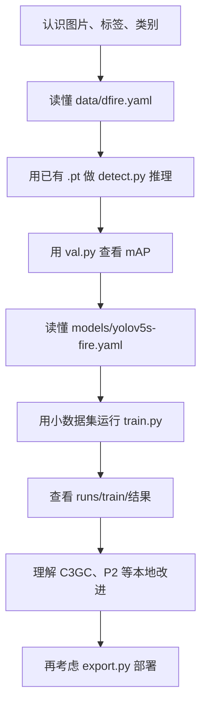

建议的实际顺序是：

1. 先理解图片、标签、类别和权重。
2. 使用现有权重做一次推理，不要一开始就训练。
3. 查看输出图片，确认模型确实能运行。
4. 使用 `val.py` 了解 Precision、Recall 和 mAP。
5. 再阅读 `train.py` 和模型 YAML。
6. 最后学习 C3GC、P2、模型导出和部署。

这样可以把复杂仓库拆成一个个小问题：先知道“怎么用”，再理解“怎么训练”，最后理解“怎么改模型”。
