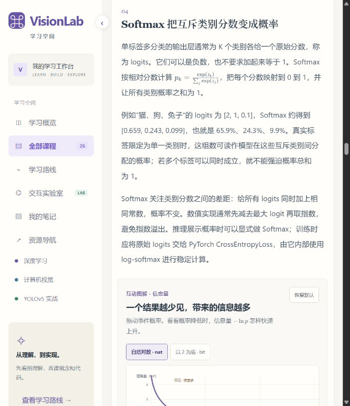
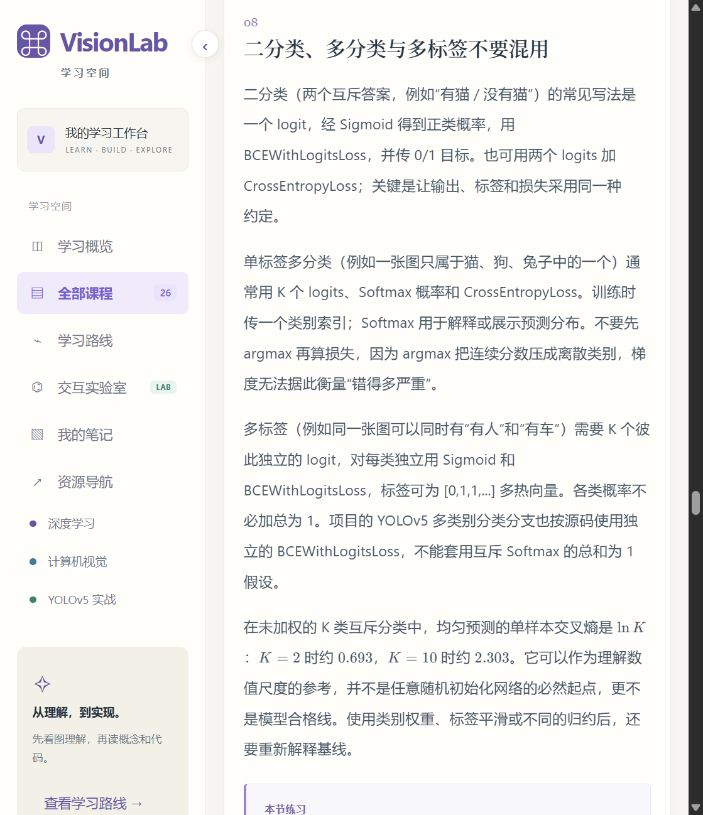
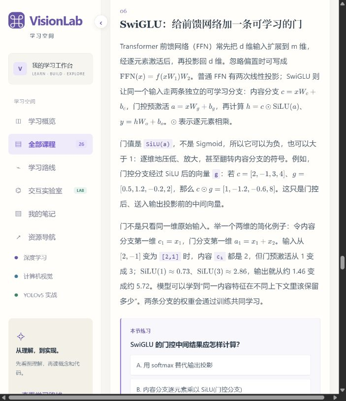

# VisionLab 全站零基础教材审查与修改清单

审查日期：2026-10-20。审查目标：读者不具备深度学习基础，能通过本站正文、图解、实验和练习建立概念，而不是依靠外部搜索补齐术语。

本次交付是审查报告与修改清单，尚未实施下述网站改造。

## 1. 审查范围和证据

- Sites 最新保存版本：86；其源码提交为 `06a2fbbe62552c3ef93d31c111995f0afb72f09e`，与审查时本地 HEAD 一致。原浏览器标签上的 `?v=79` 只是 URL 查询参数，不能作为当前源码版本的可靠证据。
- 按 `dist/index.html` 的实际脚本顺序合成最终课程数据，覆盖全部 **26 门课、179 个正文小节**。不能只审查 `data.js` 或某一份旧课程数据，因为多个后续脚本会覆盖和追加内容。
- 第一遍逐课检查定义、前置知识、例子、公式和层级；第二遍按术语出现顺序、课程依赖、正文与交互位置复核。检查了全部课程的正文、现有先修说明、主要代码示例、例题和练习数据，并检查课程交互渲染入口、图解渲染入口及实验室源码。
- 浏览器重新读取实际网站，抽样核验损失课第 4/8 节、网络课第 6 节、学习路线、独立实验室，保存本次截图。前四处截图已检查；实验室已读取实际页面结构，但首张截图显示未稳定，复拍时浏览器连接超时，故不纳入已接受的可视证据。网页核验是代表性抽样，并未声称逐一操作全站所有实验的全部组合。
- 核对 PyTorch 官方入门教程及 CE/BCE/Softmax 接口文档，确认“原始分数 → 概率 → 损失”讲解应遵循的数学与接口边界。本次没有运行全站 Python 示例，也没有逐条重新证明所有论文结论。
- 仓库 `AGENTS.md` 已要求“新概念第一次出现时，先解释是什么、处理什么、为什么需要”。目前的实际内容与此要求仍有明显差距。

## 2. 总体判断

网站已经积累了不少正确的定义、具体算例和有效的交互；主要问题是这些内容尚未按初学者的认知顺序组织起来。存在定义过短、定义晚于使用、未解释的新词成串出现、进阶内容进入必读主线、前置课程倒置，以及新增小节后图解仍按旧数字索引挂载的问题。

“正文出现过一次名称”不等于完成教学。例如，称 logits 为“原始分数”只完成命名，没有回答分数由谁算出、为什么允许为负、它与概率有什么关系。增加 Tooltip 也不能代替正文里的首次完整教学。

优先级：**P0** 为会阻断零基础主线或造成直接误解的问题；**P1** 为正文、例题、交互和练习需要系统补齐的问题；**P2** 为在基础路径完整后处理的扩展内容。

## 3. 必须先修的全站问题

| 编号 | 优先级 | 已核实的问题 | 修改要求 | 验收方式 |
| --- | --- | --- | --- | --- |
| G01 | P0 | 没有统一术语注册表或统一术语解释组件。源码未检出 `plainExplanation`、`metaphor`、`data-term` 或 `role=tooltip` 的现有实现。 | 建立统一术语数据源；所有条目必须有非空 `title`、`plainExplanation`、`metaphor`。正文、图例、表格、交互标签、提示、题目与解析均复用它。 | 扫描约定的专业术语和别名，查找裸露术语；检查字段完整性、未知引用及同名词含义冲突。 |
| G02 | P0 | 前置知识仅是字符串，渲染成普通文字，没有直接补课路径。实际路线有迁移学习先于 CNN、增强先于检测标签等倒置。 | 用可跳转的先修概念/课程标识建立依赖图；基础内容就近解释，较长前置提供精确到小节的链接；按依赖重排主线。 | 从未学习过的新用户视角，沿“接下来”阅读，不出现必须先懂后面课程才能继续的环节。 |
| G03 | P0 | 初始状态把 `state.last` 设为 `tensor`；首页优先按它选下一课，却显示“从第一章开始”。新用户可能直接进入第二章。 | 区分新用户和真实续读状态；新用户从 AI 入门/准备课开始，续读才用已保存位置。 | 使用独立的新会话状态核验首页 CTA、章号、实际目标一致；保留既有用户的进度。 |
| G04 | P0 | 公式之前未普遍建立所用数学概念，符号解释也不完整；常见例子包括 `exp`、`ln`、Σ、∂、∇、范数、转置、Φ。 | 增加就近的数学小补丁；每个公式附“每个符号指什么、代入哪些数、结果如何解释”，先具体算例再抽象写法。 | 不看外部资料，能说清公式的输入、每个新符号、计算步骤和输出意义。 |
| G05 | P0 | 有些初级课程把内存布局、SwiGLU、KL、AdamW、AMP、GGUF 等与入门步骤放在同一条必读路径。 | 每章明确“基础主线 / 进阶展开”；进阶内容有先修说明，基础章的核心例题与测验使用已教会的概念。 | 折叠进阶部分后，基础主线仍完整，且能完成本章基础任务。 |
| G06 | P0 | 损失课的交互按旧小节数字挂载，实页出现 Softmax→信息量、信息量→熵/KL、熵→Softmax 的位置错配。 | 修复当前挂载关系，并改为稳定的小节 ID 绑定图、实验、公式与练习。 | 插入/重排一个小节后，相关图文和练习仍归属同一概念；现有例子位置逐项核对。 |
| G07 | P1 | 多处先给 API 名称和输入形状，随后讨论排错边界，初学者还没有完成一次成功计算。 | 正文统一采用“具体问题 → 名称和定义 → 小例子 → 图示/操作 → 符号 → 代码 → 边界”的次序。 | 每节前半段能独立回答“为什么学、是什么、怎么算一个最小例子”。 |
| G08 | P1 | 数据集、样本、标签、batch 在前面几章就使用，正式说明却分散在更后面的训练章。Python 基础和运行环境又被直接作为先修。 | 增加轻量准备入口：样本与标签、训练与推理、数组与索引、最小 Python/PyTorch 操作。概念学习可直接开始；代码实践有明确准备步骤。 | 不会编程的读者能先走概念路径；想运行代码的读者能按站内步骤得到可核对的第一份输出。 |
| G09 | P1 | 示例中的 B/N、x/y、预测与标签、xywh、通道与类别等符号和约定易跨节混淆。 | 为每节提供符号/单位说明；明确局部约定，例如 N 在当前段表示样本数还是目标数，xywh 的 x/y 是中心还是左上角。 | 跨课对照时能看出约定变化，不凭变量名猜单位或语义。 |
| G10 | P1 | 已有图解引导和实验任务，但尚未统一覆盖初学者的先认概念、再观察变量、最后解释结果。 | 所有实验交代输入、操作、过程、输出、观察问题和简化条件；给不操作控件也能阅读的默认算例。 | 实验不是只剩滑杆和曲线；读者能解释调了什么、结果为什么变化。 |
| G11 | P1 | 图中文字、题目选项和代码说明有各自的渲染路径，未来只改正文富文本会漏掉大量术语。 | 覆盖 `rich()`、图解 `spec.draw()/guide`、各交互 HTML 模板、练习解析和实验室文案；图片内的术语配相邻图例或可访问热点。 | 同一术语在正文、图和交互中能打开相同解释；代码复制内容保持原样，解释由相邻注释/标注提供。 |
| G12 | P1 | 资源页主要提供外部资料；部分课程一开始依赖读者已有运行环境或阅读源码能力。 | 为每份外部资料写清前置、用途和建议阅读段落；本站核心概念闭环解释，外部资料用于延伸与核对。 | 不打开外部链接，也能完成本站基础理解题。 |

证据入口：`dist/textbook-app.js:2` 的初始状态；`dist/textbook-ui-v3.js:46` 的 `rich()`、`:61` 的正文渲染及 `:340` 的先修说明；`dist/textbook-v2.js` 的 `idOrder`；`dist/textbook-playgrounds.js:876` 开始的损失课交互挂载分支；`dist/textbook-figures.js` 的图解独立渲染路径。

## 4. 全部 26 门课逐课修改清单

下表的位置按本次合成后的有效课程小节编号记录。每行均需配套接入 G01 的术语组件，不能仅修改正文一处名称。

| 课程 / 位置 | 已核实的理解障碍 | 具体修改 | 优先级 |
| --- | --- | --- | --- |
| 01 AI 入门 `ai-foundations` §1–4 | 从“多层计算组成的函数”和 `y=f(x)` 起步；函数、样本、标签、参数、训练/推理的角色未形成完整入门链。 | 增加“输入一张照片，系统要给什么答案”的贯穿例子；解释 AI、机器学习、深度学习和神经网络的关系；先用输入输出表解释函数，再解释样本、标签、权重、偏置和训练。现有单神经元手算保留。 | P0 |
| 02 张量 `tensor` §1–9 | §2 已同时进入矩阵乘法、广播、点积和叉积；轴数的专节在其后；大量篇幅进入 storage/stride/offset/连续性。 | 先完成数字→列表→表格→多层分组→轴和 shape；补一行乘一列的逐项乘加动画；基础主线教形状、索引、常用变形；内存布局、连续性与叉积作为可选扩展。解释 dtype/device/uint8/float32。 | P0 |
| 03 梯度 `gradient` §1–8 | §2 就出现偏导、Σ、范数和一阶近似；清楚的一次手算更新在 §5。导数直觉与严格推导混在同段。 | 把现有 §5 单样本算例前移；先比较参数改一点时损失怎样变，再引出斜率、导数、偏导和梯度；用有箭头的最小计算图讲链式法则；多分支、叶子张量、None 与零梯度放进排错扩展。 | P0 |
| 04 首个网络 `network` §2–8及章末 | §3 用二分类 logit，直到 §8 才给一句定义；§5–7 引入 GELU、Transformer、FFN、SwiGLU；本章主要例题和代码也是 SwiGLU。 | logits 的最小解释前移到首次使用前；基础主线用两输入小网络，展示 Linear 的每次乘加、ReLU 前后、最后原始分数；说明 PyTorch Linear 的仿射计算。BN 已有基础定义和算例，应保留并安排统计量先修；SwiGLU/参数预算另设进阶单元，基础例题换成小网络前向计算。 | P0 |
| 05 分类损失 `losses` §1–13 | logits 只被命名为原始分数；Softmax 直接给公式；BCE 只给接口选择，没有独立惩罚定义和手算；KL/数值稳定性挤入主线；交互错位。 | 按第 5 节的完整方案重组；CE、BCE、BCELoss、BCEWithLogitsLoss 的名称和职责逐一解释；补二分类正/负样本算例及分数→概率→损失的同步图；修复挂载。 | P0 |
| 06 优化器 `optimizer` §1–8 | 开头即用 SGD、Adam、一阶/二阶移动统计；后面又引入 L2、AdamW、AMP、GradScaler、范数裁剪和调度时钟。 | 从“已经有梯度，怎样改一个参数”开始，给 SGD 全称和更新表；先用连续三个数解释移动平均，再讲动量；Adam 的 m/v 用可视化数表解释；AdamW、裁剪和混合精度列为进阶，逐词补定义。 | P0 |
| 07 训练循环 `training` §1–12 | batch 的正式解释在此才出现；训练模式直接引用 Dropout/BN；核心循环与 state_dict、GGUF、量化、云 API 混为一章。 | 把样本/标签/batch 基础提前共享；用“8 张图、每批 2 张”逐步播放前向、损失、求梯度、更新与验证。解释 DataLoader、epoch/iteration/step、checkpoint、patience；模型文件格式和运行方式移至部署扩展，尾批/累积保留为进阶。 | P0 |
| 08 泛化与正则化 `regularization` §1–4 | 过拟合有说明，但正则化用方法列表代替统一定义；Dropout、早停、checkpoint 等需要更多具体机制。 | 用“背答案与做新题”说明泛化；对照欠拟合/过拟合的具体预测和曲线；解释正则化为何限制拟合方式；用节点开关展示 Dropout，给早停和 patience 的逐轮表，并链接权重衰减的基础算例。 | P1 |
| 09 迁移学习 `transfer` §1–4 | 声明先修 CNN，实际排在 CNN 前；骨干/头部、源域/目标域及冻结语义未就近完整说明。 | 调整到 CNN 基础之后；用旧任务→换输出头→先冻结→逐步解冻的图解释；注明冻结参数、是否求梯度、BN 运行统计和训练模式是不同事项；提供从哪些层到哪些层的可视化。 | P0 |
| 10 图像 `image` §1–4 | 首节从 HWC/CHW 和 OpenCV 开始，像素与 RGB 数值本身没有先展开；均值、标准差、标准化、letterbox 相继出现。 | 增加可点选的 2×2 彩色图片，查看一个像素的 R/G/B 三个数；解释亮度范围、8 位整数与浮点数；先对照通道换序，再做布局换轴；用小数列说明均值/标准差；逐步展示等比例缩放、补边与坐标还原。 | P0 |
| 11 四元数 `quaternion` §1–8 | 虽有轴角例子，仍要求先懂三维向量和三角函数，随后直接进入单位化、共轭、逆元及 qpq*，没有足够的四元数乘法入门过程。 | 移到三维空间选修支线；补原点、坐标轴、向量、长度、角度/弧度、正余弦及右手定则；讲清四个分量如何编码旋转；用一步步乘法展开转动一个向量，再比较欧拉角、矩阵和四元数，解释自由度与万向节锁。 | P1 |
| 12 CNN `cnn` §1–23 | 最小逐项卷积算例在 §5，§2 已集中给卷积形状、分组、膨胀等术语；同一章还包含 LeNet/AlexNet/VGG/ResNet、有效感受野与外部演示。 | 把单通道乘加台前移，完成一个输出格再扩展到整图、多通道；按需介绍 stride/padding/dilation；拆为卷积基础、网络组合、经典结构、进阶感受野等单元。历史名称首次出现解释来历与作用；FLOPs、LRN、RBF、归纳偏置等提供术语卡。 | P0 |
| 13 池化 `pooling` §1–4 | 已有良好的 2×2 最大/平均值例子，但“激活”、ceil_mode、全局平均池化及边界行为缺少初学者过渡。 | 保留现有手算；先说明激活值就是该位置的计算结果；用 3×3/5×5 小网格逐窗展示步幅、末尾不足窗口的处理；把全局平均池化画成每通道一张表→一个数。 | P1 |
| 14 增强 `augmentation` §1–4 | 先修写 YOLO 标签格式，而对应课在后面；第一节实验已显示归一化标签；hue/饱和度/曝光等没有统一解释。 | 在增强前安排框坐标/标签入门，或在实验内提供补课卡；先看原图→单次变化→框同步变化；每个颜色参数单独配前后对照和生活比喻，再讨论组合增强。 | P0 |
| 15 视觉任务 `tasks` §1–8 | 在卷积和增强之后才系统说明分类/检测/分割；扩展同时出现 mask、热力图、OKS、GAN、U-Net、扩散、PSNR/SSIM。 | 基础任务地图前移到像素课后；同一图片对照输入、答案、标注；解释语义与实例、框与掩码；关键点和生成另设扩展卡，每个模型名/指标给最小定义，避免把任务、结构、训练方法混作同一分类。 | P0 |
| 16 边界框/IoU `iou` §1–4 | 已有交并集定义和具体数值，属于相对完整的基础讲解；仍需明确图像坐标原点、y 方向及 xywh 的中心/左上角约定。 | 补坐标读法和框表示互转图；IoU 给全称 Intersection over Union 与中文名；保留现有 100/50/150 算例并内嵌可操作框；首次提及真阳性和 NMS 时解释并链接，不提前展开整套评估。 | P1 |
| 17 指标/NMS `metrics` §1–4 | TP/FP/FN 虽有英文及匹配说明，初学者仍需先看具体误报/漏报；F1 只有名称；AP/mAP 正文没有完整逐项计算。 | 用“3 个真实物体、若干预测框”的账本逐个标 TP/FP/FN；算 Precision/Recall，再画阈值改变下的 PR 点；补 F1 公式和数字；把已有实验室 AP 逐步计算纳入正文；宏/微平均和复杂协议置于进阶。 | P0 |
| 18 数据质量 `data-quality` §1–4 | 分布、独立性、哈希、过采样、切片评估、困难负样本等与基础数据概念交错。 | 用重复连拍/新地点图片说明分布与泄漏；建立类别数量、目标大小和错误类型的可视化账本；用一张“看起来像目标但其实不是”的背景图解释困难负样本；哈希/统计方法作为工具扩展。 | P1 |
| 19 YOLOv5l 结构 `architecture` §1–16 | 开篇即有 Conv/C3/SPPF、P3/P4/P5、Backbone/Neck/Detect；图和层表技术细节多，模块名称未全部有基础定义；引用 Anchor 等后置课程。 | 总览先用“提特征→合信息→出答案”讲三个部件，并提供中文/英文名称；每个模块可展开“做什么、输入、内部、输出”；在深入层表前补网格/anchor 简介。先用实图通路建立意义，再读 YAML 和层号；模块内部、残差、Concat 和形状表保留，原始分数/概率/解码逐步解释。 | P0 |
| 20 检测数据集 `dataset` §1–5 | 已有较好的坐标归一化算例；YAML、txt、names、class、相对路径和标注协议的使用仍假设读者熟悉文件与配置。 | 加一张原图、一个标签文件、一个 data YAML 的完整可对照案例；图中拖框同步展示像素坐标和 txt 数字；逐行解释字段、缩进、类号、文件名配对与路径基准。用实际目录树核对具体版本的路径规则。 | P1 |
| 21 Anchor `anchors` §1–4 | 已称 anchor 为宽高参考值，但缺少一个网格、一个模板和一个真实框的完整匹配/偏移算例；“正样本”直接用于解释匹配。 | 先说明候选、预测、真值和正/负样本；把图片覆上网格，拖一个目标看中心/宽高如何换单位；并排展示 anchor 模板与最终框；逐步演示一次匹配，再展开多个尺度和邻格规则。 | P0 |
| 22 YOLO 损失 `yolo-loss` §1–4 | 目前多为分项和诊断概述；box/obj/cls、目标性、正负分配与 BCE/CIoU 之间没有贯穿计算。 | 用同一张图、一个真值和几个候选，分别讲“在哪、是否值得当目标、是什么”；说明哪些位置参与哪项损失。补 IoU→中心距离→长宽比的 CIoU 入门；展示加权汇总；明确当前实现的物体性目标可能使用 IoU 软值，而非一律 0/1。 | P0 |
| 23 YOLO 训练 `train-yolo` §1–4 | 先修直接要求已有可运行环境；命令行参数、终端/目录、workers、精度等缺乏共同起点；“本地 train.py 曾修改”依赖开发上下文。 | 补环境/终端操作入口，给从打开终端到运行小样本的完整演示；逐个解释命令参数与日志列；配成功输出、保存路径和错误示例；把内部改动叙述改为通用且可核对的“显式指定数据配置”；DFL 和 AMP 另列扩展。 | P0 |
| 24 YOLO 策略 `yolo-augment` §1–4 | data/model/hyp YAML 容易混淆；Mosaic、HSV、imgsz、schedule 等在配置层直接使用。 | 用三份配置的职责图对照；Mosaic 展示四张图与框怎样组合；HSV 单项示例；用输入宽高翻倍时像素数量四倍的例子解释计算预算；给一份一次只变一个因素的对照实验表。 | P1 |
| 25 推理/导出 `inference` §1–4 | 推理前后处理术语密集；“ONNX、TorchScript、OpenVINO、TensorRT 等格式”把模型表示、工具链和运行时混在一起。 | 用同一张图逐步走预处理→模型→分数→筛框→坐标还原；逐词解释两个阈值。将文件/模型表示、运行时/工具链、硬件分栏：ONNX 是模型表示，OpenVINO/TensorRT 是工具链/运行平台并有相应模型/引擎产物。解释延迟、吞吐、FPS、batch 和精度模式，再做部署比较。 | P1 |
| 26 故障排查 `debugging` §1–4 | 多为建议列表，DataLoader、缓存、有限值、梯度断开、候选框等名词仍需要读者带着前面知识进入。 | 改成“看到什么现象→检查哪个值/图→正常例子→异常例子→下一步”的诊断树；每个检查术语可展开；给 None、0、NaN、Inf 的对照；让读者用一个小故障案例走完推理链。 | P1 |

## 5. 交叉熵课的具体重写顺序

基础主线建议用两个一致的小故事：先是“有猫/没猫”的二分类，再是“猫/狗/兔”的互斥多分类。每一步使用同一组输入与标签，避免不同故事的数字和符号突然交替。

1. **先解释预测和真实答案。** 模型给一个数或一组数，标签表示正确答案；损失是比较它们后得到的惩罚。先用预测温度偏差说明“一个数如何评价答得怎样”。
2. **概率的最小基础。** 0、0.5、1 各表示什么；互斥类别的概率总和为什么是 1；多标签为何可同时成立；百分比与小数互转。
3. **logit 从哪里来。** 用最后一层 `z=w·x+b` 真的算出一个原始数；说明它可正可负、不等于百分比。先给可读定义，之后才使用 logits 作为后续段落的解释词。二分类的对数几率关系可放侧栏；多分类的一组分数不能各自孤立当成二分类概率。
4. **Sigmoid。** 输入一个原始数，输出一个 0～1 的正类概率；零分数得到 0.5。滑杆同时显示原始数、曲线上对应点和概率，不只显示函数名。
5. **BCE 的名称、惩罚与公式。** Binary Cross Entropy，二元交叉熵。解释 `L=-[y ln p+(1-y)ln(1-p)]` 的每个符号；y=1 时只剩 `-ln p`，y=0 时只剩 `-ln(1-p)`。p=0.8、真实为正，损失约 0.223；同样 p=0.8、真实为负，损失约 1.609。先讲这个对照，再讲接口。
6. **Softmax。** 给三个原始分数，逐项显示取指数、求和、相除。解释 exp、e、Σ、类别索引；将“为什么不能直接除以分数总和”变成带负数的反例。同步操作某一类分数，观察全部概率如何改变。
7. **标签与 CE。** 类别编号、独热标签各是什么；Cross Entropy，交叉熵。用正确类概率计算一次 `-ln p_true`，再用独热求和式表达同一件事；把 argmax 与求损失区分。
8. **多标签。** 两个可同时成立的问题分别给分、Sigmoid 和 BCE；用多热标签与单标签独热并排比较。术语“各标签独立建模/分别监督”不能被解释为现实世界的标签必然统计独立。
9. **最后介绍 PyTorch 接口。** `BCELoss` 输入概率；`BCEWithLogitsLoss` 直接输入原始分数并在内部以稳定形式结合 Sigmoid 与 BCE；`CrossEntropyLoss` 输入多类 logits，常见硬标签为类别编号，内部组合 log-softmax/NLL。逐项解释形状、类型、`dim`、`mean` 与 `sum`。公式演示里的“先算概率”与训练 API 的直接 logits 输入必须在图上区分。
10. **进阶内容后置。** 信息量→熵→交叉熵分解/KL，再到梯度 p-y、类别权重、标签平滑、概率校准和 logsumexp。每项都有独立前置说明，基础学习不以先理解 KL 为条件。

当前已核实的交互挂载错位：

| 正文小节 | 当前出现的实验 | 应放置的实验 |
| --- | --- | --- |
| §4 Softmax | 信息量 | 原始分数→Softmax 概率 |
| §5 信息量 | 熵 / 交叉熵 / KL | 单事件概率→负对数信息量 |
| §6 熵与交叉熵 | Softmax 与交叉熵滑杆 | P/Q 分布与平均惩罚 |
| §9 类别不平衡 | 从损失到参数更新 | 不平衡/按类误差实例；更新流程归入 §10 |

本课还出现“独热标签”在 §5 的追加段落被使用、直到 §7 才正式解释的次序问题。不能只修 logits 一个词。

## 6. 术语数据和组件的明确要求

每个术语必须包含用户指定的三字段，并通过同一数据源维护。例如：

```json
{
  "id": "logit",
  "title": "logit / logits（原始分数）",
  "plainExplanation": "模型在转换成概率之前给出的原始分数，可以是任意实数。",
  "metaphor": "像评委先给每个候选打的原始分，还没有换算为概率。",
  "aliases": ["logits", "原始分数"],
  "learnMore": "#lesson/losses/logit-intro"
}
```

上面的 `learnMore` 是拟议的稳定小节 ID，当前网站还没有这个路由。实现时须先建立实际目标，不能留下假链接。

- `title` 写中文名、英文名/全称、缩写；logit 等非缩写词不杜撰全称。
- `plainExplanation` 用初学者已经学过的词说一句话。不能把“未归一化的对数几率得分”当成 logit 的唯一入门解释，因为它又引入两个未解释的词。
- `metaphor` 提供生活比喻，但在展开卡里说明比喻的边界；原始分数的例子不能暗示模型分数已经校准。
- 可选字段：`aliases`、`formalDefinition`、`example`、`prerequisiteTerms`、`symbolNotes`、`learnMore`、`source`。术语之间的解释依赖也要检查，避免互相循环定义。
- 所有专业术语出现时均使用统一组件。首次出现的核心概念同时有正文教学；重复出现仍保留可打开的解释，视觉上可轻量呈现。
- 电脑支持悬浮和键盘聚焦；触屏支持点按。简短解释用 Tooltip，长内容进入可展开卡/侧栏。不能只依赖浏览器原生 title，也不能仅支持 hover。
- 气泡以 `aria-describedby` 等方式关联术语；长卡有明确标题、关闭方式和焦点返回。解释自身包含的新专业词同样可展开。
- 富文本、交互生成的 HTML、图例、练习问题/选项/解析和术语搜索共用同一词条。代码块用相邻的术语注释或标注层讲解，复制得到的代码不插入组件标签。
- 图片内已烘焙的文字无法直接套文字组件，需提供逐项对应的图例/热点；SVG 可给具体术语节点绑定解释，并提供文字替代说明。

第一批词条应覆盖：

| 领域 | 必补词组 |
| --- | --- |
| 通用起点 | AI、机器学习、深度学习、模型、函数、变量、输入、输出、样本、标签、特征、参数、超参数、训练、推理、预测、真值 |
| 数学与数据 | 标量、向量、矩阵、张量、轴、shape、索引、批次、均值、方差、标准差、概率、概率分布、指数、对数、求和、导数、偏导、梯度、范数 |
| 网络与训练 | 全连接/Linear、权重、偏置、仿射、激活、ReLU、Sigmoid、Softmax、logit、BN、Dropout、损失、CE、BCE、MSE、MAE、Huber、优化器、SGD、动量、Adam、epoch、iteration、DataLoader、checkpoint |
| 图像与空间 | 像素、RGB/BGR、通道、HWC/CHW/NCHW、归一化、标准化、卷积核/滤波器、特征图、stride、padding、dilation、池化、感受野、坐标、边界框、掩码、欧拉角、四元数 |
| 检测与评估 | Backbone、Neck、Head、C3、Bottleneck、SPPF、FPN、PAN、网格、anchor、候选、正负样本、objectness、分类分数、置信度、解码、IoU、CIoU、NMS、TP/FP/FN、Precision、Recall、F1、AP、mAP |
| 实践扩展 | YAML、路径、权重文件、state_dict、buffer、CPU/GPU、显存、dtype、FP32/FP16、AMP、量化、ONNX、运行时、TensorRT、API、延迟、吞吐、NaN、Inf、None |

这是一批明确的补全范围，不是“全站只有这些术语”的穷尽声明。经典网络、三维旋转和生成任务的专用术语仍须随对应单元补齐。

## 7. 独立页面、图示、练习和实现边界

| 页面/载体 | 修改清单 |
| --- | --- |
| 首页 | 修复新用户起点；用具体学习任务解释三个阶段；“特征、张量、检测”等入口词可直接解释。 |
| 目录与路线 | 显示基础主线与选修分支；按依赖排序；给每章“你将先学会什么”，避免以术语堆叠描述学习收益。 |
| 先修说明 | 改成可点的具体概念和小节，不只写“懂 CNN/梯度/矩阵”；从任一章节直接进入也能补上缺口。 |
| 独立实验室 | 当前默认“完整检测流程”，第一屏已经出现验证集、Anchor、NMS、归一化标签等。增加“本实验需要认识的词”和新手推荐顺序；每个标签页独立解释自己的变量，图、控件、结果和任务解析都覆盖术语组件。 |
| 图解/表格/公式 | 给新出现的符号、通道和单位就地解释；保持正文与图中的命名一致；长公式分步显示，窄视口可读，避免只有缩小后的公式。 |
| 自测 | 区分基础理解与进阶推导；在尚未教过概念时不考其定义；加“说出含义、代入小数、预测操作结果、解释异常”四类题，解析也提供术语支持。 |
| 代码示例 | 开头说明运行位置、输入文件/变量、依赖和预期输出；逐行对应概念与图解。不能让“可复制”代替“能理解、能运行”。 |
| 资源导航 | 标注入门/进阶、阅读目的和本站对应概念；核心定义留在站内；外部英文文档用于追溯和扩展。 |

工程层面需消除两类脆弱依赖：小节依靠数组序号绑定实验，练习答案也以小节序号保存。重排课程时要使用稳定 ID 并迁移已保存的答案/阅读位置，否则旧答案可能落到新题上。不能为修教学顺序而破坏学习记录。

## 8. 建议实施顺序与完成标准

1. **术语基础设施与零基础入口。** 落地三字段注册表、通用解释组件、先修跳转和新用户入口；建立后续内容共同使用的最小数学/数据解释。
2. **深度学习必读主线。** 依次修张量基础、网络/原始输出、最小损失、一次梯度更新、优化器和训练循环。梯度与网络的严格推导可有独立进阶支线，基础读者先完成一个可解释的预测与更新闭环。
3. **视觉必读主线。** 像素/通道→任务答案→卷积/池化→框与坐标/IoU→标注/增强→检测指标→迁移与泛化。基础数据划分应提前说明，检测数据质量分析在指标之后深化。
4. **YOLO 实战主线。** 网格/anchor 简介→Backbone/Neck/Head 总览→逐层模块→分配与损失→训练→推理。详细 anchor 分配和模块数学可互相链接，不制造循环先修。
5. **进阶归位与全站回归。** 安排 SwiGLU、KL、数值稳定性、AMP、模型文件、经典网络和三维旋转；再逐页核对图文、题目、公式、术语和持久化进度。

完成标准：

- 新手不借助外部检索，能说出本节所有核心术语的意思；点击其他专业词也能获得三字段解释。
- 同一节能够完成至少一个输入→计算/操作→输出的具体例子，并解释为什么得出这个结果。
- 核心公式先有问题和数字，再有符号；每个新符号都能找到含义与单位。
- 所有先修都已经出现，或有明确的补课入口；课程不存在必须先读后面章节的硬依赖。
- 初学者主线可以独立完成；进阶块不是通过基础测验的隐含条件。
- 每个实验的正文、图例、控件与结果使用相同名词；插入/重排小节不改变挂载归属。
- 术语字段检查、术语引用检查、先修依赖检查与代表性浏览器阅读检查形成发布门槛。
- 重新验证新用户、已有进度用户、键盘访问、触屏点按及窄屏阅读。不能只看页面没有报错就认定教材合格。

## 9. 本次网页核验步骤和截图

| 步骤 | 实页位置 | 状态 | 证据 |
| --- | --- | --- | --- |
| 1 | 损失课 §4 Softmax | 定义过短，公式前置不足，实验挂载错位 | [截图 01](assets/01-loss-softmax.png) |
| 2 | 损失课 §8 二分类/多标签 | 接口选择有说明，BCE 计算教学缺失 | [截图 02](assets/02-loss-bce.png) |
| 3 | 网络课 §6 SwiGLU | 初级课程主线进入尚未铺垫的进阶网络结构 | [截图 03](assets/03-network-swiglu.png) |
| 4 | 学习路线 | 能访问全部课程，但顺序与声明先修不一致 | [截图 04](assets/04-learning-path.png) |
| 5 | 独立实验室 | 实际页面结构与源码已核对；有预测任务和合成示例说明，仍缺统一术语支持与新手起点 | 页面结构记录及 `textbook-lab.js` / `textbook-pipeline.js`；首张截图未接受，复拍因浏览器连接超时未完成 |

### 代表性截图








`assets/05-lab.png` 仅保留为未接受的采集记录，不用于视觉质量判断。实验室的教学内容问题依据本次实际页面结构和源码判断。

## 10. 官方核对资料

- [PyTorch：Build the Neural Network](https://docs.pytorch.org/tutorials/beginner/basics/buildmodel_tutorial.html)：从模型原始输出到概率的例子，以及 Flatten、Linear、ReLU、Softmax 的逐步讲解。
- [PyTorch：CrossEntropyLoss](https://docs.pytorch.org/docs/stable/generated/torch.nn.CrossEntropyLoss.html)：接收未归一化 logits；常见硬标签与软目标约定；与 LogSoftmax/NLLLoss 的关系。
- [PyTorch：BCEWithLogitsLoss](https://docs.pytorch.org/docs/2.14/generated/torch.nn.BCEWithLogitsLoss.html)：结合 Sigmoid 与 BCE 的稳定实现、目标范围及权重选项。
- [PyTorch：BCELoss](https://docs.pytorch.org/docs/2.14/generated/torch.nn.BCELoss.html)：以概率为输入的二元交叉熵计算。
- [PyTorch：Softmax](https://docs.pytorch.org/docs/2.14/generated/torch.nn.Softmax.html)：沿指定维度将分数转为和为 1 的概率。

本报告的教学判断以当前站点内容和初学者阅读任务为依据；引用文档用于核对术语和接口，不表示这些文档替代本站必须完成的基础讲解。
